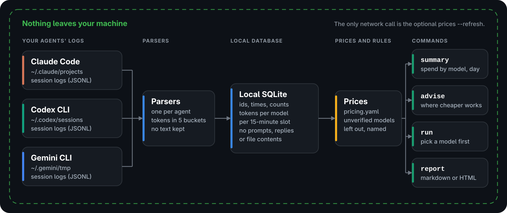

**English** | [Português (Brasil)](README.pt-BR.md)

<p align="center">
  
</p>

# AgentFare

Know what your AI coding agents cost, and where a cheaper model would have done the job.

[](https://github.com/FernandoSLuz/agentfare/actions/workflows/ci.yml)
[](LICENSE)
[](pyproject.toml)
[](#requirements-and-where-agentfare-reads)
[](#privacy)
[](https://www.buymeacoffee.com/fernandosluz)

[Quick start](#quick-start) | [Screenshots](#screenshots) | [Configuration](#configuration-in-60-seconds) | [Limitations](#limitations) | [FAQ](#faq-and-troubleshooting)

AgentFare reads the session logs that Claude Code, Codex CLI and Gemini CLI already write on your machine and prices each session from its token counts. It shows where a cheaper model would probably have done the job, and it can pick a model for your next task before you start it. Sessions live in a local SQLite file, prices in a YAML table you can edit, and nothing leaves your machine except the optional `agentfare prices --refresh`.

Token prices differ a lot between models. In this repository's price table `gpt-6-astra` costs $10.00 per million input tokens and `gpt-6-luna` costs $0.10, a factor of 100. An agent that stays on its most expensive model for every task pays that rate for small jobs too, so renaming a variable costs the same per token as designing a migration. A spend report gives you the total. AgentFare also estimates how much of it a cheaper model would probably have saved. `advise` looks back over your sessions and re-prices each one on a cheaper model when it looks small enough. `run` looks ahead: it picks a model for a task from the prompt and the size of the repository, shows the pick and an estimated cost, and starts your agent only after you confirm. The savings are estimates and the project is alpha, so read the [Limitations](#limitations) before you act on a number.


## Try it in 10 seconds

`agentfare demo` runs the real `summary` and `advise` on 45 invented sessions that ship inside the package, so you need none of your own logs. It never reads your agent folders or `~/.agentfare`, writes only to a temporary directory and opens no network connection. The first line of its output says the data is synthetic.

```sh
uvx --from git+https://github.com/FernandoSLuz/agentfare agentfare demo
```

`uvx` comes with uv ([how to install uv](https://docs.astral.sh/uv/getting-started/installation/)). It runs AgentFare in a throwaway environment and installs nothing. With AgentFare installed (see the [quick start](#quick-start)) the command is `agentfare demo`:

```sh
agentfare demo                          # spend, top 3 pieces of advice, next steps
agentfare demo --keep ./agentfare-demo  # keep the invented data to explore it
agentfare demo --report week.html       # also write the report of the demo week
```

## Quick start

Three steps: install it, run `agentfare init` once, then look at your bill and your savings. You need Python 3.11 or newer, Linux or macOS, and at least one of Claude Code, Codex CLI or Gemini CLI with some history.

### 1. Install

AgentFare is not on PyPI yet, so every command below installs it from GitHub, which needs git on your machine. uv is the quickest way: it keeps AgentFare in its own environment, puts `agentfare` on your PATH and can fetch a Python 3.11 or newer when yours is older ([how to install uv](https://docs.astral.sh/uv/getting-started/installation/)).

```sh
uv tool install git+https://github.com/FernandoSLuz/agentfare
```

pipx does the same job:

```sh
pipx install git+https://github.com/FernandoSLuz/agentfare
```

With plain pip, use a virtual environment (many systems refuse a system-wide pip install) and activate it whenever you want to run AgentFare:

```sh
python3 -m venv ~/.venvs/agentfare
. ~/.venvs/agentfare/bin/activate
pip install git+https://github.com/FernandoSLuz/agentfare
```

Check that it runs:

```sh
agentfare --version
```

If the shell answers `command not found`, the folder the installer uses is not on your PATH. `uv tool update-shell` or `pipx ensurepath` fixes it, then open a new terminal. Until then run `~/.local/bin/agentfare`, where uv and pipx put the command by default. With the pip install, activate its environment or run `~/.venvs/agentfare/bin/agentfare`.

Contributors install from a clone instead. [CONTRIBUTING.md](CONTRIBUTING.md) has the full dev setup.

```sh
git clone https://github.com/FernandoSLuz/agentfare
cd agentfare
python3 -m venv .venv
. .venv/bin/activate
pip install -e .
```

To update, run the line that matches how you installed it. A database written by an older release is upgraded in place the next time a command opens it.

```sh
uv tool upgrade agentfare
pipx upgrade agentfare
pip install --upgrade git+https://github.com/FernandoSLuz/agentfare
```

To uninstall:

```sh
uv tool uninstall agentfare
pipx uninstall agentfare
pip uninstall agentfare
```

Uninstalling leaves `~/.agentfare` (your database and config) where it is. The [FAQ](#faq-and-troubleshooting) says how to delete it.

Tab completion is off until you ask for it. `agentfare --install-completion` installs it for your current shell by editing that shell's startup files, and `agentfare --show-completion` prints the script instead so you can place it yourself. No other command touches a shell file.

### 2. Set up with agentfare init

Run this once. It finds the log folders of the three agents, says what it found, reads the logs into a local database and prints your total and the biggest saving it sees. On a large history the read takes about a minute.

```sh
agentfare init
```


The screenshot is `init` on the invented sessions of the demo. Yours shows your own folders and numbers. Before it reads anything, `init` prints the folders it will look at and says that it stores only metadata and token counts, never prompts, replies or file contents, and that it changes nothing in those folders. It is safe to run again: only new or changed logs are read, and an existing config file is never overwritten.

```sh
agentfare init --dry-run        # only look, change nothing
agentfare init --write-config   # also write ~/.agentfare/config.yaml
agentfare doctor                # check the setup, get a fix for what is off
```

AgentFare works without a config file, so `--write-config` is optional. If `init` finds no sessions it says so and points to `agentfare doctor` (what is wrong and how to fix it), to `sources` in the config (where to look when your agent keeps its logs elsewhere) and to `agentfare demo`.

### 3. See your bill and your savings

```sh
# spend by model, project and day
agentfare summary
# where a cheaper model would have done the job
agentfare advise
# the weekly report as one self-contained page
agentfare report --format html -o week.html
# the model the router picks for a task, without starting anything
agentfare run --dry-run -- claude -p "fix the typo in the README"
```

`summary` adds up what you spent. `advise` lists the sessions where a cheaper model would probably have done the job, with a one-line reason each. `report` writes the page you can post or keep. `run --dry-run` shows what the router would choose for a task before you start it; without `--dry-run` it asks for confirmation and then starts your agent with that model. The [screenshots](#screenshots) show what each one prints, and [Configuration in 60 seconds](#configuration-in-60-seconds) covers the settings people change first.

## Requirements and where AgentFare reads

* Python 3.11 or newer. The test suite has been run on 3.11, 3.12 and 3.14, and CI covers 3.11 to 3.14.
* Linux or macOS. CI runs on Ubuntu and macOS, and the author has only used it on Linux (see [Limitations](#limitations)).
* One or more of Claude Code, Codex CLI or Gemini CLI, with session history on the same machine. `agentfare run` also needs the agent's command on your PATH.
* Four runtime dependencies: Typer, Rich, PyYAML and Jinja2. The database is the SQLite in Python's standard library.

AgentFare scans these folders, recursively:

| Agent | Default folders | Moved with |
|---|---|---|
| Claude Code | `~/.claude/projects` | `CLAUDE_CONFIG_DIR` (its `projects` folder) |
| Codex CLI | `~/.codex/sessions` and `~/.codex/archived_sessions` | `CODEX_HOME` (`sessions` and `archived_sessions`) |
| Gemini CLI | `~/.gemini/tmp` | `GEMINI_CLI_HOME` (`.gemini/tmp` below it) |

A `sources:` entry in the config replaces these for an agent ([Configuration in 60 seconds](#configuration-in-60-seconds)). It reads files only, and never changes anything in those folders. Its own data lives in `~/.agentfare` (`AGENTFARE_HOME` or `--home` moves it).

## Screenshots

Every picture on this page comes from the 45 invented sessions of `agentfare demo`. None of it is a recording of a real person's work.

### Where the money went


`agentfare summary` adds up the spend by model, project and day. A model without a verified price stays out of the total, which then ends in `+`, and a warning names it.

### Where a cheaper model would have done the job


`agentfare advise` re-prices each session on a cheaper model when its size says that is reasonable, and prints the reason in one line. The table at the bottom adds it up per week.

### Pick a model before the task starts


A heavy task keeps the heavy model, and the panel shows which words and sizes decided it. A light task moves to a cheaper model and shows the estimated saving (a screenshot of that is under More screenshots).

### The weekly report

`agentfare report --format html` writes one self-contained page, with no script and no network reference. It follows the colour scheme of the viewer and has a phone layout. Project names appear as `Project A`, `Project B` unless you pass `--show-projects`. Click a picture to see it full size.

<p>
  <a href="docs/images/report-dark.png"></a>
  <a href="docs/images/report-light.png"></a>
</p>

<details>
<summary>The same report on a phone</summary>

<p>
  <a href="docs/images/report-mobile.png"></a>
</p>

</details>

<details>
<summary>More screenshots: a light task, models, sessions and prices</summary>


</details>

## What you get

* One command, `agentfare init`, finds your agents' log folders, reads them and prints your total. `agentfare doctor` checks the install, the config, the folders, the database and the prices, and gives a fix for every line that is not ok.
* It prices each session from its token counts, in integer micro-cents, from a YAML table that records the source page and the date of every price. You can override any price.
* Money belongs to the moment it was spent. A session that runs across midnight or a week boundary is split between the days and weeks it ran in, so `summary`, `sessions`, `models`, `advise` and `report` agree for the same period.
* `advise` re-prices each past session on a cheaper model when it looks small enough, with the signals behind the call in one line. `run` picks a model for the next task and starts your agent only after you confirm. Both use a few thresholds you can read and change in the config, and neither uses a model.
* A weekly report as GitHub markdown or one self-contained HTML page in a light and a dark theme.
* A model with no verified price is left out of every dollar total and named in a warning, so a total never hides a gap.
* `--json` on every reporting command, with stable keys and money as `{"cents": ..., "ucents": ...}`. Output that is not a terminal has no colour codes.
* Local only. Sessions go to a SQLite file, no telemetry exists, and `agentfare prices --refresh` is the only command that opens a connection.
* `run` works with any agent command, not just the three whose logs it can read. Add your own under `agents:` in the config.

## How it works



[The same diagram as SVG](docs/images/how-it-works.svg). Each parser reads one log file line by line, skips lines it cannot read and record types it does not know, removes responses the agent logged twice, and returns one record per session, with the tokens of each response under the time of that response. [docs/ARCHITECTURE.md](docs/ARCHITECTURE.md) has the module map and the invariants, and [docs/LOG-FORMATS.md](docs/LOG-FORMATS.md) documents each log format.

### Privacy

* AgentFare stores ids, project names, times, counts of tool calls, files and prompts, and token counts per model and 15-minute slot.
* It never stores, prints or reports prompts, replies, tool inputs or outputs, or file contents. The parser tests plant a marker string in every content field of the sample logs and fail if it reaches a session record, and `tests/test_e2e_fixtures.py` searches the raw bytes of the data directory for it after an ingest.
* It opens no network connection, except in `agentfare prices --refresh`. `tests/test_no_network.py` enforces that with a scan of the source and a runtime guard that blocks sockets while every other command runs.
* Everything it creates is private to you: new directories are `0700` and new files `0600`.
* Reports hide project names unless you pass `--show-projects`, because reports get posted.

<details>
<summary>What is stored: the three tables, the file paths and the file modes</summary>

The database is a plain SQLite file with three tables:

| Table | Columns |
|---|---|
| `sessions`, one row per session | `key`, `agent`, `session_id`, `project`, `started_at`, `ended_at`, `wall_seconds`, `active_seconds`, `tool_calls`, `files_touched`, `error_retries`, `turns`, `prompts`, `primary_model`, `source_path`, `ingested_at` |
| `session_usage`, one row per session, model and 15-minute slot | `key`, `model`, `slot`, `input`, `cache_read`, `cache_write`, `cache_write_1h`, `output` |
| `ingested_files`, so unchanged logs are not read again | `path`, `agent`, `signature`, `sessions` |

Prompts, replies, tool inputs and outputs, and file contents are never copied into a record. `tool_calls`, `files_touched`, `error_retries`, `turns` and `prompts` are counts, and `project` is the name of a repository or directory, never a full path. The parser tests plant a marker string in every content field of the sample logs and assert that it never reaches a session record, and `tests/test_e2e_fixtures.py` searches the raw bytes of the data directory for it after an ingest.

`source_path` and `ingested_files.path` are the paths of the log files. For Claude Code the folder name in that path is the encoded working directory of the project, so the database does contain the directory names of your projects. Reports hide project names unless you pass `--show-projects`.

The data directory is `~/.agentfare` (set `AGENTFARE_HOME` or `--home` to move it). The database schema is versioned with `PRAGMA user_version` (currently 3) and upgraded in place: a database from an older release is rebuilt when the next command opens it, its old rows go to the slot the session started in, and the logs are read again (`ingested_files` is cleared) so every response lands in its own slot. A database written by a newer release is refused with an error and left as it is, and one that cannot be read is an error message with a hint: delete the file and the next run rebuilds it from the logs that still exist.

What AgentFare creates is private to you, whatever your `umask` says: a new data directory is `0700` and a new database `0600` (so are its `-journal` and `-wal` files), `config --init` and a new `pricing.yaml` from `prices --refresh --write` are `0600`, and so is every file `report` writes. A directory or file that already exists keeps the mode it has. Files are replaced through a fresh temporary file, and the default report name (`agentfare-report-<week>.html`) is created without following a symbolic link planted there, so a link cannot redirect a write. A config or price file whose YAML aliases expand to more than 100,000 values is refused with an error instead of being loaded, and control characters or bidirectional overrides in a name taken from a log, a server reply or an error message are shown as `?`. A named pipe among the logs is skipped, so a scan never hangs on it. A project name, session id or model id from a log is stored at most 200 characters long (a longer one keeps its start and ends in `...` and eight hex digits). A config or price file is read only when it is a regular file of at most 10 MB, and a `--prompt-file` of at most 2 MB, so `/dev/zero` or a named pipe ends in one `error:` line instead of a hang. A key written twice in a mapping of a config or price file is an error that names the key and the line (`duplicate key input at line 5`).

</details>

<details>
<summary>No network except one command</summary>

Only `agentfare prices --refresh` opens a connection. `tests/test_no_network.py` enforces it twice. A static scan fails when any module other than `pricefetch.py` imports a network-capable module or hides an import, and a runtime guard blocks sockets and process creation while every other command runs against the fixtures. `--refresh` never edits a price: it reports what the official pages show and leaves the decision to you.

</details>

### Money is attributed to when it was spent

<details>
<summary>How a session that runs across midnight or a week boundary is split</summary>

A session can run for hours or days, across midnight or across a week boundary. AgentFare does not book all of it on the day the session started. Every response carries its own timestamp, and its tokens go to the UTC 15-minute slot that timestamp falls in (`2026-09-28T09:45:00Z` covers 09:45:00 to 09:59:59). A day or an ISO week is then the sum of the slots inside it, converted to your `timezone`. That is why `summary`, `sessions`, `models`, `advise` and `report` agree for the same period: a total is the money spent inside the period, whichever day the sessions started.

A session that spans the edge of a period is in the period with only its share. It counts as one session there (in the `Sess` column of `summary`, in the `sessions` list, in the weekly table), and as one session in a total that covers both sides. Its counters (prompts, tool calls, files touched, active time) and its complexity score stay whole-session, because they describe the session, not the period. `sessions` marks such a session with `*` and `"clipped": true` in `--json`; `advise` scores it on its whole usage and puts each week's share of the money in that week. A response whose record has no usable timestamp counts at the time the session started.

</details>

### Money is an integer

<details>
<summary>Micro-cents, the five token buckets and a worked sum</summary>

All amounts are integer micro-cents, where one cent is 1,000,000 micro-cents. A price is a decimal number of dollars per million tokens, a session's cost is the sum over five token buckets of tokens times price, computed with exact decimals and rounded half up once, and every total is a sum of integers, so floats never touch an amount. Display shows whole cents from $1 up (`$4.20`), and below $1 it shows two decimals when the amount is a whole cent and four when it is not (`$0.0592`). `--json` prints every amount as `{"cents": ..., "ucents": ...}`.

Each parser maps its agent's counters onto the same five buckets, so pricing never double counts:

| Bucket | What it holds | Priced at |
|---|---|---|
| `input` | Uncached input tokens | `input` |
| `cache_read` | Input served from the prompt cache | `cached_input` (the input price when the table has none) |
| `cache_write` | Cache writes with the default 5-minute lifetime | `cache_write` (the input price when the table has none) |
| `cache_write_1h` | Cache writes with the 1-hour lifetime, which only Claude Code logs | `cache_write_1h` (then `cache_write`, then `input`) |
| `output` | Output tokens including reasoning and thinking tokens | `output` |

For the Codex session in the sample logs (40,000 uncached input tokens, 60,000 cached and 6,000 output on `gpt-6-astra`, at $10, $1 and $50 per million):

```
40,000 x $10 + 60,000 x $1 + 6,000 x $50 = $0.40 + $0.06 + $0.30 = $0.76 = 76,000,000 micro-cents
```

</details>

### Unverified prices

A price the provider's page did not confirm is the word `unverified` in the price table. A model whose input or output price is unverified, or that is not in the table at all, is left out of every dollar total: the total gets a trailing `+` (for example `$3.41+`), the model's cost cell says `unverified` (`unknown` when the model is not in the table), and a `warning:` block names the model and how many tokens were not counted. A model with a verified input and output price but an unverified cached-input or cache-write price is still counted, with those tokens billed at a fallback rate (the input price), and the warning says so. `advise` goes one step further and gives no advice on a session that has any unpriced usage, because a percentage saved on half a session would mean nothing. `agentfare prices --unverified` lists the affected rows.

## Configuration in 60 seconds

AgentFare works with no config file. To change something, write the file with every default and its comments, then edit it:

```sh
agentfare config --init   # write ~/.agentfare/config.yaml with every default
agentfare config          # show the files and log folders in use
```

`agentfare init --write-config` writes the same file. These six settings are the ones people change first. Each snippet shows a key as it should read in the file. The file already holds every one of those keys, so change the lines that are there and do not paste a second copy: a key that appears twice is an error that names the key and the line (`duplicate key sources at line 86`). A key you delete gets its default, so a file with only the keys you change is complete. A key that does not exist (a typo) is a warning that names the key and says what you probably meant.

1. Where your logs are, when an agent keeps them outside its default folder. The value is a list of folders for that agent, and the other agents keep their defaults:

   ```yaml
   sources:
     claude: [~/work-logs/claude/projects]
   ```

2. The time zone that decides which day and ISO week a session belongs to. The default is `local`:

   ```yaml
   timezone: America/Toronto
   ```

3. The idle gap. A pause longer than this does not count as active session time. Changing it makes the next run read every log again:

   ```yaml
   idle_gap_minutes: 15
   ```

4. What `advise` compares against, and how sure it must be. This example compares light and medium sessions with `claude-sonnet-5-5`, keeps heavy ones, advises a switch only when it is at least twice as cheap, and lists a session on its own line only above 25 cents:

   ```yaml
   router:
     recommend: {light: claude-sonnet-5-5, medium: claude-sonnet-5-5, heavy: null}
     min_saving_ratio: 2
     advise: {min_cost_cents: 25}
   ```

   The recommended model must be in the price table with a verified price. The signal thresholds and the tier cuts live under `router` too (see [How the router decides](#how-the-router-decides)).

5. Prices. A file at `~/.agentfare/pricing.yaml` replaces the built-in table, and `pricing_file` points at another path:

   ```yaml
   pricing_file: ~/prices/my-prices.yaml
   ```

   [Overriding prices](#overriding-prices) shows how to start from a copy of the built-in table.

6. The agents `agentfare run` knows. Add a command under `agents:` and give it a model for each tier:

   ```yaml
   agents:
     aider: {commands: [aider], model_flag: "--model"}
   router:
     run:
       models:
         aider: {light: claude-sonnet-5-5, medium: claude-sonnet-5-5, heavy: claude-opus-5-5}
   ```

[Every config key](#every-config-key) lists the rest, with its default and what it does.

## Command reference

The outputs below come from the three synthetic sessions in [`tests/fixtures/`](tests/fixtures/) (one per agent), printed with `COLUMNS=100`. They are small enough to check by hand and are not the invented sessions of the screenshots. [Reproduce these outputs](#reproduce-these-outputs) shows how to get them on your machine, and a test fails when they drift from the real output. Every dollar amount is worked out by hand, token by token, in [`tests/fixtures/EXPECTED.md`](tests/fixtures/EXPECTED.md).

### Every command

```sh
agentfare init                          # find your logs, read them, show the total
agentfare doctor                        # check the setup, get a fix for each problem
agentfare demo                          # try it on 45 invented sessions
agentfare ingest                        # scan the logs now (--json: as data)
agentfare summary                       # spend by model, project and day
agentfare summary --week                # only the current ISO week
agentfare summary --since 2026-09-01    # from that day on (--until ends a range)
agentfare summary --project acme-shop   # one project, matched in any case
agentfare summary --top 5               # the 5 biggest projects and 5 latest days
agentfare sessions --sort cost -n 10    # the ten dearest sessions
agentfare models                        # ranking with effective and list price
agentfare advise                        # where a cheaper model would have done it
agentfare advise --all                  # every session, also those in the totals
agentfare report --format md            # the weekly report as markdown on stdout
agentfare report --format html -o week.html
agentfare run --dry-run -- claude -p "fix the typo in the README"
agentfare config --init                 # write ~/.agentfare/config.yaml
```

<details>
<summary>Periods, filters and narrow terminals</summary>

The header of every report names its period: `all time`, `week 2026-09-28 .. 2026-10-04`, `from 2026-09-01`, `up to 2026-09-30` or `2026-09-01 .. 2026-09-30`. Days are written `YYYY-MM-DD` and follow your `timezone`, and a period view holds the money spent inside it, which `summary` and `models` say under the header. `--agent claude` (or `codex`, `gemini`) keeps one agent. When `--project` matches no project at all, the empty result lists the names that start with it or contain it, then those spelt about like it (or your biggest projects) instead of only saying that nothing was found. The match ignores case and the tables list names as they are written, so `work` and `Work` are two rows that `--project work` finds together.

`summary --top N` (10 by default) shows the N biggest projects and the N latest days and folds the rest into one row such as `2 more (total $0.98)`. It folds only when that hides at least two rows, the table title then says `(top 5 by spend)` or `(latest 5 days)`, `--top 0` lists every row, and `--json` always does. Tables are made for 80 columns. On a narrower terminal a model or project name is cut at its end with an ellipsis, never to the same text as another row, then the least useful columns are left out with a line that says which (`--json` has everything), and no number is ever cut.

</details>

### Reading the logs

Every command that reads data scans the logs first when something changed, so you rarely need to start a scan yourself.

<details>
<summary>How the scan works, <code>agentfare ingest</code> and <code>--no-ingest</code></summary>

The first command that needs data scans `~/.claude/projects`, `~/.codex/sessions`, `~/.codex/archived_sessions` and `~/.gemini/tmp` and fills the database. If you moved an agent's data directory, the agent's own environment variable is followed: `CLAUDE_CONFIG_DIR` (its `projects` folder), `CODEX_HOME` (`sessions` and `archived_sessions`) and `GEMINI_CLI_HOME` (`.gemini/tmp` below it). A `sources:` entry in the config overrides them. On a large history that first scan takes about a minute, and it says so on stderr: `first run: reading your agent logs into a local database; this can take a minute`. An agent whose own scan runs past two seconds adds `still reading <agent> logs...` once. Later runs parse only the files that changed, and every file again when you change `idle_gap_minutes` or install a version that reads logs differently, so the numbers never describe old settings. When a scan stored anything, the report command prints `ingested 3 new/updated sessions` on stderr before its tables.

`agentfare ingest` runs the scan on its own (`--full` re-reads everything, `--agent claude` scans one agent, `--json` prints the result as data) and says what it did, for example `read 12 session records from 14 files (14 parsed, 0 unchanged); the database holds 11 distinct sessions`. A session that is found in more than one file, say an archived log and its live copy, is stored once, from the copy with the most tokens, and a warning counts such sessions: `1 session appears in more than one log file; the copy with the most tokens was kept`. A log that cannot be read is named on stderr with the OS error (`PermissionError: Permission denied`), the scan goes on with the other files, and the last line of `ingest` says how many files failed. The `--json` object has the keys `files_seen`, `files_parsed`, `files_unchanged`, `sessions_read` (records), `sessions_stored` (distinct sessions stored by this run), `by_agent`, `database` (`path` and `sessions`, every distinct session it holds), `missing_roots`, `errors`, `files_failed` and `duplicate_sessions`.

The global `--no-ingest` skips the scan, and opens an existing database of the current version read-only, so a file you may not write to still answers. On a database that was just upgraded and not yet re-read, it says once on stderr `database upgraded: day and week splits are approximate until agentfare ingest has re-read your logs`. If the database has no sessions at all, an empty result points to `agentfare ingest` and to `agentfare config`, which lists the log directories it looks in and marks the missing ones. Otherwise it says which dates do have data, for example `data exists from 2026-08-01 to 2026-09-30`.

</details>

### Example output

<details>
<summary><code>agentfare summary</code> prices the sessions and adds them up by model, project and day</summary>

<!-- run: agentfare summary -->
```
AgentFare summary: all time
3 sessions, 3 projects, 4 models, total spend $3.63

Spend by model
                                       Cache  Cache
Agent   Model             Sess  Input   read  write  Output     Cost  Share
───────────────────────────────────────────────────────────────────────────
claude  claude-opus-5-5      1  39.2k   3.1M   155k   42.9k    $2.59  71.4%
codex   gpt-6-astra          1  40.0k  60.0k      0    6.0k    $0.76  20.9%
gemini  gemini-2.5-pro       1  92.0k  80.0k      0    9.5k    $0.22   6.1%
claude  claude-haiku-4-5     1   4.7k   120k  18.0k    2.2k  $0.0592   1.6%
───────────────────────────────────────────────────────────────────────────
Total                        3   176k   3.3M   173k   60.6k    $3.63   100%
a session that used several models counts once per model; the Total row counts it once

Spend by project
                             Cache  Cache
Project         Sess  Input   read  write  Output   Cost  Share
───────────────────────────────────────────────────────────────
acme-shop          1  43.9k   3.2M   173k   45.1k  $2.65  73.0%
fake-repo          1  40.0k  60.0k      0    6.0k  $0.76  20.9%
demo-notes-app     1  92.0k  80.0k      0    9.5k  $0.22   6.1%
───────────────────────────────────────────────────────────────
Total              3   176k   3.3M   173k   60.6k  $3.63   100%

Spend by day
                         Cache  Cache
Day         Sess  Input   read  write  Output   Cost  Share
───────────────────────────────────────────────────────────────────────
2026-09-28     1  43.9k   3.2M   173k   45.1k  $2.65  73.0%  ██████████
2026-09-29     1  40.0k  60.0k      0    6.0k  $0.76  20.9%  ███
2026-09-30     1  92.0k  80.0k      0    9.5k  $0.22   6.1%  █
───────────────────────────────────────────────────────────────────────
Total          3   176k   3.3M   173k   60.6k  $3.63   100%
```

</details>

<details>
<summary><code>agentfare advise</code> compares each session with a cheaper model</summary>

<!-- run: agentfare advise -->
```
AgentFare advise: all time
3 sessions, 1 with a switch advised

1. session 7c8d9e0f: you spent $0.76 on gpt-6-astra → gpt-6.1-sol would likely have handled this for
   ~$0.1460 (5.2x cheaper)
   codex, fake-repo, 2026-09-29: score 2/10 (light): files_touched 2 +1, active_minutes 10 +1
2 more sessions where no switch is advised (heavy, already cheaper, no verified price): $2.87 spent;
--all lists them.

Router savings (per ISO week)
Week      Sess  Switched   Actual   Router    Saved  Saved %
────────────────────────────────────────────────────────────
2026-W40     3         1  $3.6310  $3.0170  $0.6140    16.9%
────────────────────────────────────────────────────────────
Total        3         1  $3.6310  $3.0170  $0.6140    16.9%
Of the saving, $0.6140 (100%) comes from sessions with prompts and $0.00 (0.0%) from sub-agent or
background threads with 0 prompts.
Sess fully priced sessions, Switched sessions with an advised switch, Router the same spend with
every advised switch applied

Note: Each estimate re-prices the same token counts on the recommended model. Tokenizers and caching
differ and answer quality is not measured, so read it as a hint, not a promise.
```

The Codex session cost $0.76 on `gpt-6-astra`. The same tokens on `gpt-6.1-sol` cost $0.146, which is 5.2x less, so `advise` suggests the switch. The Claude Code session scored 7 of 10 (heavy) and is kept as it is, and the Gemini CLI session already costs less than `gpt-6.1-sol`. The weekly table adds it up: $0.614 of $3.63, or 16.9%, and the line under it says how much of that came from sessions you prompted and how much from sub-agent or background threads. Each figure re-prices the same tokens on another model. Whether that model would have done the job is not measured (see [Limitations](#limitations)).

</details>

<details>
<summary><code>agentfare sessions</code> lists one line per session, newest first</summary>

The counters are prompts, tool calls, files touched and tool errors, and a `+1` after the model means the session used one more model. In a period view (`--week`, `--since`, ...) a session that runs across the edge of the period shows only what it spent inside it, and a `*` after its cost says so:

<!-- run: agentfare sessions -->
```
AgentFare sessions: all time

Date  Agent  ID       Project        Model              Active Prm Tool File Err Tokens  Cost
─────────────────────────────────────────────────────────────────────────────────────────────
09-30 gemini 4a6e8f10 demo-notes-app gemini-2.5-pro      9m55s   3    7    2   1   182k $0.22
09-29 codex  7c8d9e0f fake-repo      gpt-6-astra        10m00s   1    5    2   1   106k $0.76
09-28 claude a1c7e402 acme-shop      claude-opus-5-5 +1  1h38m   5   46   10   5   3.5M $2.65
Prm prompts, Tool tool calls, File files touched, Err tool errors
showing 3 of 3 sessions, total $3.63
```

</details>

<details>
<summary><code>agentfare models</code> ranks the models by spend</summary>

It sets the price you effectively paid per million tokens next to the list price:

<!-- run: agentfare models -->
```
AgentFare models: all time
4 models, 3 sessions, total spend $3.63

                                                              Blended  List in  List out
#  Model             Provider   Sess  Tokens    Spend  Share     $/1M     $/1M      $/1M
────────────────────────────────────────────────────────────────────────────────────────
1  claude-opus-5-5   anthropic     1    3.3M    $2.59  71.4%  $0.7813    $4.00    $20.00
2  gpt-6-astra       openai        1    106k    $0.76  20.9%    $7.17   $10.00    $50.00
3  gemini-2.5-pro    google        1    182k    $0.22   6.1%    $1.21    $1.25    $10.00
4  claude-haiku-4-5  anthropic     1    145k  $0.0592   1.6%  $0.4086    $1.00     $5.00
```

</details>

<details>
<summary><code>agentfare run --dry-run</code> shows the router's decision without starting anything</summary>

Without `--dry-run` the same panel goes to stderr, you confirm, and the agent starts with the chosen model:

<!-- run: agentfare run --dry-run -- claude -p "fix the typo in the README" -->
```
╭─ agentfare run (dry run) ────────────────────────────────────────────────────────────────────────╮
│ agent     claude                                                                                 │
│ prompt    26 chars, from the command line                                                        │
│ tier      light (score 0)                                                                        │
│           - light keywords typo, readme: -3                                                      │
│           - medium keyword fix: +1                                                               │
│ model     claude-sonnet-5-5 (router pick)                                                        │
│ estimate  ~$0.3125 on claude-sonnet-5-5, typical light task (no history yet)                     │
│ baseline  ~$0.5050 on claude-opus-5-5 (your most used claude model in the last 30 days, since    │
│           2026-08-31)                                                                            │
│ saving    ~$0.1925 (38.1% less than the baseline)                                                │
│ command   claude --model claude-sonnet-5-5 -p '<prompt: 26 chars>'                               │
╰──────────────────────────────────────────────────────────────────────────────────────────────────╯
```

</details>

### The weekly report

The weekly report is GitHub markdown or one self-contained HTML page.

<details>
<summary>Options, privacy of project names and how the headline is worded</summary>

`--format md` prints GitHub markdown and `--format html` writes one self-contained page with no script and no network reference (`-o -` prints either to stdout instead of writing a file). `--week-of 2026-W39` picks the week (the default is the latest week with spend), and project names appear as `Project A`, `Project B` unless you pass `--show-projects`, because reports get posted. The headline leads with the saving in the sessions you prompted yourself: `In sessions you prompted yourself, a cost router would have saved 16.9% ($0.61) of the $3.63 they cost`. That is the figure to quote, because you chose the model of those sessions. The all-sessions figure comes second and is labelled as including sub-agent and background threads, whose model nobody chose. When some sessions are only partly priced (a model without a verified price), each percentage states its base, for example `of the $48.00 that could be compared`, and when none of the sessions you prompted could be compared the report says so and gives the all-sessions figure alone. A week that has not ended says `Week in progress` instead of a percentage change against the last one.

</details>

### Reproduce these outputs

The outputs above need a throwaway data directory, a frozen clock and the fixture config. Run this from the clone:

```sh
export AGENTFARE_HOME=$(mktemp -d)
export AGENTFARE_NOW=2026-09-30T12:00:00Z
export AGENTFARE_CONFIG=$PWD/tests/fixtures/config.yaml
export COLUMNS=100
agentfare summary
```

The `run` example counts the files under the current directory, so start it from a small one. The clone itself has more than 200 files, which is where the repo size rule starts to add points, and the panel would gain a `repo has ... files` line. `cd "$(mktemp -d)"` before `agentfare run` fixes that, because `AGENTFARE_CONFIG` is an absolute path. `run` only reads the database and never creates it, so run `agentfare summary` (or `ingest`) first, as above, to give it the history the panel shown in this README draws on. `bash scripts/demo.sh` runs the whole tour with the same settings.

## Using it with any agent

`agentfare run` wraps any agent command. Everything after `--` is the command, passed through untouched except for one added model flag:

```sh
agentfare run -- claude -p "refactor the billing module"
agentfare run -- codex exec "rename the helper in notes.py"
agentfare run -- gemini -p "add a docstring to parse()"
agentfare run --prompt-file task.md -- claude       # a prompt the command line lacks
agentfare run --force-model claude-opus-5-5 -- claude
agentfare run --yes -- claude -p "fix the typo"     # no question, for no terminal
```

<details>
<summary>What run prints, how it asks, how it hides arguments, and its exit codes</summary>

The decision panel goes to stderr, so the agent's own output stays clean, and `--dry-run` prints it on stdout and stops (`--dry-run --json` prints it as data). `run` never reads your logs and never creates the database, so it is instant: it only reads the history that an earlier `ingest`, `summary` or other report command stored, which means its estimate and its baseline use the last scan. `run` never starts an agent before showing the decision. On a terminal it asks `Run this?`, and without a terminal it needs `--yes`: otherwise it prints an error, starts nothing and exits with code 3. The prompt is shown as its length and never as text, and so is every other argument, because a flag can hold a secret (`--api-key sk-...`): only the program, the subcommand words it knows (`exec`, `resume`, `mcp`, ...), the model flag with its value and the names of the flags are shown, and the rest reads `<arg: N chars>`. The agent still gets every argument untouched. The agent starts with its own stdin, stdout and stderr, and gets `AGENTFARE_TIER` and `AGENTFARE_MODEL` in its environment.

If the command already selects a model (`claude --model ...`), that choice wins and the router pick is only advisory. Naming a different model with `--force-model` is a usage error. When the command line carries no prompt, as in an interactive session, the prompt rules are skipped with a note, and `--prompt` or `--prompt-file` adds them.

| Exit code | Meaning |
|---|---|
| the agent's own | The agent ran. A kill by signal N gives 128 + N |
| 1 | You answered no at `Run this?` |
| 2 | Usage or configuration error |
| 3 | Stdin is not a terminal and there is no `--yes`, so nothing was started |
| 126 | The command cannot be run |
| 127 | The command is not found |

</details>

### Custom agents

Any command can be routed. Add it under `agents:` and give it models under `router.run.models`. Its commands are matched by basename, and `model_flag` is the option that takes a model:

```yaml
agents:
  aider: {commands: [aider], model_flag: "--model"}
router:
  run:
    models:
      aider: {light: claude-sonnet-5-5, medium: claude-sonnet-5-5, heavy: claude-opus-5-5}
```

```sh
agentfare run --prompt "rename the helper" -- aider
```

`--model-flag FLAG` names the option that takes a model for one run, in place of `model_flag` from the config. Only the prompt syntax of Claude Code, Codex CLI and Gemini CLI is understood, so a custom agent needs `--prompt` or `--prompt-file` for the prompt rules to apply. Without models for its name it runs unchanged with a warning. Logs of custom agents are not ingested, because ingestion needs a parser: [docs/LOG-FORMATS.md](docs/LOG-FORMATS.md#adding-an-agent) shows how to add one.

### Scripts and CI

`ingest`, `summary`, `sessions`, `models`, `advise`, `report`, `prices` and `run --dry-run` accept `--json` (`report --json` cannot be combined with `--format html`). Every amount is `{"cents": ..., "ucents": ...}`, shares are integer basis points, and the keys are stable. Output that is not a terminal has no colour codes, and progress notes go to stderr. The examples use `jq`, a separate tool that you may need to install.

```sh
agentfare summary --week --json | jq '.total.cents'
agentfare advise --json | jq '.total.saved.cents'
agentfare --no-ingest sessions --all --json > sessions.json   # database as it is

spent=$(agentfare summary --week --json | jq .total.cents)
[ "$spent" -le 5000 ] || { echo "agent spend this week is over \$50" >&2; exit 1; }
```

<details>
<summary>Errors, exit codes and options for scripts</summary>

Setup problems (an unreadable config, price table or database, a bad setting such as a non-numeric `idle_gap_minutes`, a bad date or filter value) print one `error: ...` line and exit with code 2, with or without `--no-ingest`. A database written by a newer release is refused the same way. An unknown option, or a value that the option parser checks itself such as `--format pdf`, also exits with 2 and prints the parser's usage message; a global option typed after the command, as in `agentfare summary --no-ingest`, is answered with where it goes (`agentfare --no-ingest summary`). `-h` is short for `--help`. `agentfare prices --refresh` exits 1 when no model could be checked at all.

</details>

| Setting | Effect |
|---|---|
| `--config FILE` or `AGENTFARE_CONFIG` | Use this config file instead of `~/.agentfare/config.yaml` |
| `--home DIR` or `AGENTFARE_HOME` | Use this data directory instead of `~/.agentfare` |
| `AGENTFARE_NOW` | Freeze today's date (ISO 8601), for demos and tests |
| `--no-ingest` | Skip the log scan and use the database as it is |

## How the router decides

The router has no model and no learning. It is a few thresholds under `router:` in `config.yaml`, integer arithmetic and one line of explanation per decision, and it reads counters and lengths, never text. This section holds every rule and every default. [docs/ROUTING.md](docs/ROUTING.md) has the exhaustive tables and the story of how the defaults were calibrated.

### `advise`: looking back

Each session is scored from 0 to 10 on five signals the parsers already extract: input tokens, tool calls, files touched, error retries and active minutes. The score picks a tier (light, medium or heavy), and a light or medium session is re-priced on a cheaper model. A switch is advised only when it is at least 1.2 times cheaper.

<details>
<summary>Signals, thresholds and tiers</summary>

Each session is measured on five signals that the parsers already extract. A signal is worth 0 points below its `medium` threshold, 1 point from `medium` and 2 points from `heavy` (the comparison is `>=`), so a session scores from 0 to 10:

<!-- generated: signals -->

| Signal | What it counts | 1 point from | 2 points from |
|---|---|---|---|
| `router.signals.input_tokens` | Every input token of the session, all models added up: uncached, cache reads and cache writes. Output tokens are left out. | 2,000,000 | 25,000,000 |
| `router.signals.tool_calls` | Tool invocations: reading, searching, editing and running commands. | 25 | 180 |
| `router.signals.files_touched` | Distinct files written or edited. A count, never names. | 1 | 6 |
| `router.signals.error_retries` | Tool calls that came back as an error. | 2 | 8 |
| `router.signals.active_minutes` | Active seconds divided by 60. Pauses longer than `idle_gap_minutes` do not count. | 10 | 80 |

<!-- /generated -->

The score picks a tier:

<!-- generated: tiers -->

| Score | Tier |
|---|---|
| 0 to 2 | light |
| 3 to 6 | medium |
| 7 to 10 | heavy |

The cuts are `router.tiers`: `light_max: 2` and `medium_max: 6`.

<!-- /generated -->

Every signal counts the same. To make one matter less, raise its thresholds, and to switch it off set both above anything you will see. There are no weights to tune. The defaults are the rounded terciles of 470 real sessions with prompts from one machine (Claude Code and Codex CLI), so about a third of sessions land in each score band per signal.

</details>

<details>
<summary>The recommend rule, what advise lists and a worked example</summary>

`router.recommend` maps each tier to the model to compare against: `gpt-6.1-sol` for `light` and `medium`, and `null` for `heavy`, which keeps whatever you used. The whole usage of the session, every model added up, is re-priced on that model bucket by bucket at its own rates. A switch is advised only when the new cost is at least `router.min_saving_ratio` (1.2) times lower. The comparison uses exact integers, so a session that is precisely 1.2 times cheaper qualifies. A session that does not qualify gets a note that says why, such as `already cheaper than gpt-6.1-sol`, `heavy: keep` or `gpt-6.1-sol is only 1.1x cheaper (minimum 1.2x)`.

By default `advise` lists at most 15 sessions (`--limit`), best saving first, and only sessions with at least one prompt that cost at least 10 cents (`router.advise.min_cost_cents`). Everything else, mostly sub-agent and auto-review threads that nobody prompted, is included in the totals and folded into one summary line per group. `--all` lists them. The weekly table counts only fully priced sessions, and each of its rows uses one precision (four decimals on all three amounts as soon as one is not a whole cent), so the columns cross-foot on screen. Under the table, one line splits the saving between sessions you prompted and sub-agent or background threads, and `report` quotes the same split.

The tier and the decision to switch belong to the whole session, taken on its tokens over its whole life, but the money follows the clock (see [Money is attributed to when it was spent](#money-is-attributed-to-when-it-was-spent)): with `--week`, a session that started the week before is scored and judged on its whole usage and shown with the part it spent inside the week. That is why the weekly rows add up to the rows of a longer period. A slice of a session that ran on a model cheaper than the advised one can show a saving below zero, and its line then says `not cheaper for the part inside this period`. A session that spans two weeks appears in both weekly rows and once in the Total row. Each slot is re-priced on its own, so a recommended model priced at a fraction of a micro-cent per token can differ from re-pricing the whole session at once by at most half a micro-cent per slot, which is never visible at cent precision.

`advise` compares prices, not what your agent can run. When the recommended model belongs to another provider than the session's, the detail line says so, and `--json` carries `"other_provider": true`.

#### Worked example

The Codex session from the sample logs, scored with the defaults:

<!-- generated: worked -->

| Signal | Value | medium | heavy | Points |
|---|---|---|---|---|
| `input_tokens` | 100,000 | 2,000,000 | 25,000,000 | 0 |
| `tool_calls` | 5 | 25 | 180 | 0 |
| `files_touched` | 2 | 1 | 6 | 1 |
| `error_retries` | 1 | 2 | 8 | 0 |
| `active_minutes` | 10.0 | 10 | 80 | 1 |
| Score |  |  |  | 2 of 10 (light) |

<!-- /generated -->

A score of 2 is `light`, so the session is re-priced on `gpt-6.1-sol`. Prices are per million tokens, so each product is divided by 1,000,000:

```
gpt-6-astra   40,000 x $10 + 60,000 x $1    + 6,000 x $50 = $0.40 + $0.06  + $0.30 = $0.76
gpt-6.1-sol   40,000 x $2  + 60,000 x $0.10 + 6,000 x $10 = $0.08 + $0.006 + $0.06 = $0.146
$0.76 / $0.146 = 5.2x, which is above the 1.2x minimum, so the switch is advised
```

The Gemini session stays as it is. It cost $0.22 on `gemini-2.5-pro` and would cost $0.287 on `gpt-6.1-sol`, so nothing is advised. The Claude Code session scores 7 (heavy) and is kept.

</details>

### `run`: looking ahead

`run` scores a task from what it can see before anything has happened: the length of the prompt, the file count of the repository and three families of keywords. Each rule that fires adds a line to the decision panel. It never reads your logs and never creates the database.

<details>
<summary>Run rules, keyword matching, the baseline and a heavy pick</summary>

`run` never scans your logs and never creates the database: it opens the existing one read-only for the history behind the estimate, so the decision appears at once even on a first run. With no database (or an empty one) it uses the default token budgets and adds the warning `no usage history yet (run agentfare ingest to personalize estimates)`.

<!-- generated: run-rules -->

| Rule | Points | Default | Config key |
|---|---|---|---|
| Prompt length in characters | +1 from `medium`, +2 from `heavy` | 400 / 1,500 | `router.run.prompt_chars` |
| Files in the repository | +1 from `medium`, +2 from `heavy` | 200 / 1,200 | `router.run.repo_files` |
| Heavy keywords | +2 for the first distinct keyword, +1 for each further one, at most 2 more | refactor, architect, migrat, redesign, rewrit, overhaul, security, concurrency, refator, arquitet, migr, reescrev, reescrit, seguranc, concorrenc | `router.run.heavy_keywords` |
| Light keywords | The same, subtracted | typo, renam, docstring, comment, format, lint, bump, readme, changelog, renomear, renome, comentar, comentario, formatar, erro de digitacao | `router.run.light_keywords` |
| Medium keywords | +1 once, however many of them match | implement, feature, debug, bug, fix, test, optimi, perform, investigat, design, integrat, endpoint, api, schema, upgrade, funcionalidade, depur, teste, otimiz, desempenho, investig, projeto, integr, corrig | `router.run.medium_keywords` |

| Score | Tier |
|---|---|
| 0 | light |
| 1 to 2 | medium |
| 3 and up | heavy |

The cuts are `router.run.tiers`: `light_max: 0` and `medium_max: 2`.

<!-- /generated -->

Keywords match the start of a word, in any case and with or without accents. `refactor` finds `refactoring` and `Refactored`, and `format` does not find `information`. A verb that changes its ending is listed as a stem, so `migrat` finds `migrate`, `migrating` and `migration`. The defaults hold English and Portuguese stems (`migr` finds `migrar`). A Portuguese stem is written without accents and long enough to leave other words alone: `seguranc` finds `segurança`, `projeto` finds `projetos` and `corrig` finds `corrigir`. Keywords that start the same word count once. The prefix is coarse on purpose: `comment` also matches `commentary`, so write a longer stem when that matters. A keyword counts once however many of its forms appear. The heavy and light families score their first keyword `router.run.keyword_points` and each further one 1 more, up to 2 more. The medium family (ordinary feature and bug work: `implement`, `fix`, `test`, `api`, ...) adds 1 once, however many of its keywords appear. If words of several families are present they add up, and the total never goes below 0. `router.run.keyword_points: 0` turns the keyword families off. Only the words from your config are ever printed, never text from the prompt.

The repository is the directory you start `agentfare run` in. Counting stops at the `heavy` threshold (shown as `1200+`), skips `.git`, `node_modules`, `.venv`, `build`, `dist`, `target`, `__pycache__` and the usual tool caches, does not follow symlinks and never opens a file.

With the default cuts, one reason is enough for `medium`, and heavy takes a third point, which means a second reason on top of a heavy keyword or a big size:

| What fired | Score | Tier |
|---|---|---|
| Nothing, or light keywords that cancel what fired | 0 | light |
| One medium keyword, one size rule at `medium` (+1), one heavy keyword, or one size rule at `heavy` (+2), or two +1 reasons | 1 or 2 | medium |
| Two heavy keywords (+2 +1), a heavy keyword with a medium keyword or any size rule, or a `heavy` size rule with a `medium` one | 3 or more | heavy |

The tier picks the model through `router.run.models`. By default Claude Code runs `claude-sonnet-5-5` for light and medium tasks and `claude-opus-5-5` for heavy ones, Codex CLI runs `gpt-6.1-sol` and `gpt-6-astra`, and Gemini CLI runs `gemini-3.1-flash-lite`, `gemini-3-flash-preview` and `gemini-3.1-pro-preview`. The panel prices a token budget on the picked model and next to it on the baseline, which is what you would have run without the router. The baseline is the model with the most spend for that agent over the last 30 days of your history, counted back from the newest spend in the database and not from the clock, so the same database always gives the same answer. With no priced spend in that window it is the model with the most spend overall, and with no priced history at all it is the agent's heavy-tier model. The panel names which one it used, and for the recent one the day the window starts (`your most used claude model in the last 30 days, since 2026-08-31`). When the pick is the baseline (an alias counts as the model it stands for) there is no saving line, because there is nothing to save, and when a different model costs as much or more the line says so instead of showing a saving. The budget is the median of your own past sessions of the same agent and tier once there are 5 of them that a person prompted, and `router.run.default_tokens` until then. The panel says which one it used.

Claude Code also takes short model names (`--model opus`) that are not in the price table. `router.run.model_aliases` says which model each one stands for so the estimate can price it (`opus` is `claude-opus-5-5` by default); the panel shows `opus (alias for claude-opus-5-5)` and the command keeps the alias you wrote. `agentfare run --dry-run --json` prints the decision as one JSON object for scripts: the tier, score, reasons, model, estimate and baseline as `{cents, ucents}`, `baseline_model`, `baseline_basis` (`recent`, `all_time` or `configured`), `baseline_since` (the first day of the 30-day window, for `recent`), and the command with the prompt replaced by its length.

A heavy pick, from the sample config after the sample sessions were read (`run` starts from the same small directory, so the repository rule does not fire):

<!-- run: agentfare run --dry-run -- claude -p "refactor the billing module and migrate it to the new API" -->
```
╭─ agentfare run (dry run) ────────────────────────────────────────────────────────────────────────╮
│ agent     claude                                                                                 │
│ prompt    57 chars, from the command line                                                        │
│ tier      heavy (score 4)                                                                        │
│           - heavy keywords refactor, migrat: +3                                                  │
│           - medium keyword api: +1                                                               │
│ model     claude-opus-5-5 (router pick)                                                          │
│ estimate  ~$43.78 on claude-opus-5-5, typical heavy task (no history yet)                        │
│ baseline  ~$43.78 on claude-opus-5-5 (your most used claude model in the last 30 days, since     │
│           2026-08-31)                                                                            │
│ command   claude --model claude-opus-5-5 -p '<prompt: 57 chars>'                                 │
╰──────────────────────────────────────────────────────────────────────────────────────────────────╯
```

</details>

### Every config key

<details>
<summary>All keys with their defaults and what they do</summary>

`agentfare config --init` writes `~/.agentfare/config.yaml` with these defaults and explanatory comments. It refuses to overwrite an existing file unless you add `--force`, which replaces even a file that is not valid YAML, and it writes to the file named with `--config` when you give one. `agentfare config --default` prints the built-in defaults, and plain `agentfare config` shows the files and log directories in use.

A key you delete gets its default. A bad value stops the command with an `error: ...` line that names the key or the value, and exit code 2, and so does a `pricing_file` that does not exist (leave it `null` to use the built-in table). A key that does not exist, usually a typo, is not an error. It is a warning on stderr that names the file and says what you probably meant, so a misspelled threshold is never silently ignored: `warning: /home/dev/.agentfare/config.yaml: unknown key router.min_saving_ratioo (did you mean min_saving_ratio?)`. The file is named as you gave it with `--config` or `AGENTFARE_CONFIG`, else by the path where it was found, else `built-in config`. A model you point `router.recommend` or `router.run.models` at that has no verified price in the price table is warned about in the same way.

`timezone: local` follows the machine's zone with its daylight-saving rules, from `TZ` (a name such as `America/Toronto` or a POSIX rule such as `EST5EDT,M3.2.0,M11.1.0`) or `/etc/localtime`. When it cannot be read as a named zone with DST rules, one warning on stderr says so and suggests an IANA name. Relative paths in the file resolve against the directory that holds it.

<!-- generated: config -->

| Key | Default | Meaning |
|---|---|---|
| `timezone` | `local` | Time zone that decides which day and ISO week a session belongs to: `local`, `UTC` or an IANA name such as `America/Toronto`. |
| `idle_gap_minutes` | `30` | A pause longer than this does not count as active session time. Changing it re-reads the logs automatically. |
| `database` | `~/.agentfare/agentfare.db` | The SQLite file. The default follows `AGENTFARE_HOME` and `--home`. |
| `pricing_file` | `null` | Price table override. `null` means `~/.agentfare/pricing.yaml` when it exists, otherwise the built-in table. A path that does not exist is an error. |
| `sources` | `{claude: [~/.claude/projects], codex: [~/.codex/sessions, ~/.codex/archived_sessions], gemini: [~/.gemini/tmp]}` | Directories scanned recursively for each agent's session logs. The second Codex directory holds threads archived in the app. An agent left at its default follows `CLAUDE_CONFIG_DIR`, `CODEX_HOME` and `GEMINI_CLI_HOME`. |
| `router.signals.input_tokens` | `{medium: 2000000, heavy: 25000000}` | Points for the total input tokens of a session (see the signals table above). |
| `router.signals.tool_calls` | `{medium: 25, heavy: 180}` | Points for the number of tool calls. |
| `router.signals.files_touched` | `{medium: 1, heavy: 6}` | Points for the number of distinct files written or edited. |
| `router.signals.error_retries` | `{medium: 2, heavy: 8}` | Points for the number of tool calls that returned an error. |
| `router.signals.active_minutes` | `{medium: 10, heavy: 80}` | Points for the active minutes of a session. |
| `router.tiers` | `{light_max: 2, medium_max: 6}` | Total score (0 to 10) to tier: `light` up to `light_max`, `medium` up to `medium_max`, `heavy` above. |
| `router.recommend` | `{light: gpt-6.1-sol, medium: gpt-6.1-sol, heavy: null}` | Model `advise` compares each tier against. `null` keeps the model you used. |
| `router.min_saving_ratio` | `1.2` | A switch is advised only when it is at least this many times cheaper. At least 1. |
| `router.advise.min_cost_cents` | `10` | A session with prompts gets its own line in `advise` only when it cost at least this many cents. The rest are summed on one line each. |
| `router.run.tiers` | `{light_max: 0, medium_max: 2}` | Score of a `run` pick (0 to 9 with the defaults) to tier, like `router.tiers`. |
| `router.run.prompt_chars` | `{medium: 400, heavy: 1500}` | Prompt length that adds 1 point (`medium`) and 2 points (`heavy`). |
| `router.run.repo_files` | `{medium: 200, heavy: 1200}` | File count of the repository that adds 1 point (`medium`) and 2 points (`heavy`). |
| `router.run.heavy_keywords` | `[refactor, architect, migrat, redesign, rewrit, overhaul, security, concurrency, refator, arquitet, migr, reescrev, reescrit, seguranc, concorrenc]` | Word stems that add points. A stem matches every word that starts with it. |
| `router.run.light_keywords` | `[typo, renam, docstring, comment, format, lint, bump, readme, changelog, renomear, renome, comentar, comentario, formatar, erro de digitacao]` | Word stems that subtract points, matched the same way. |
| `router.run.medium_keywords` | `[implement, feature, debug, bug, fix, test, optimi, perform, investigat, design, integrat, endpoint, api, schema, upgrade, funcionalidade, depur, teste, otimiz, desempenho, investig, projeto, integr, corrig]` | Word stems of ordinary feature and bug work: they add 1 point, once, however many of them match. |
| `router.run.keyword_points` | `2` | Points for the first matching keyword of a heavy or light family. `0` turns the keyword families off. |
| `router.run.model_aliases` | `{opus: claude-opus-5-5, sonnet: claude-sonnet-5-5, haiku: claude-haiku-4-5, fable: claude-fable-5-1}` | Short model names an agent CLI accepts (`--model opus`) that are not in the price table: the estimate prices an alias as the model named here. Your entries are merged over these. |
| `router.run.models.claude` | `{light: claude-sonnet-5-5, medium: claude-sonnet-5-5, heavy: claude-opus-5-5}` | Model `run` picks for Claude Code, per tier. |
| `router.run.models.codex` | `{light: gpt-6.1-sol, medium: gpt-6.1-sol, heavy: gpt-6-astra}` | Model `run` picks for Codex CLI, per tier. |
| `router.run.models.gemini` | `{light: gemini-3.1-flash-lite, medium: gemini-3-flash-preview, heavy: gemini-3.1-pro-preview}` | Model `run` picks for Gemini CLI, per tier. |
| `router.run.default_tokens.light` | `{input: 30000, cache_read: 600000, cache_write: 25000, output: 7000}` | Token budget behind the cost estimate of a light task, until there are 5 past sessions of the same agent and tier. |
| `router.run.default_tokens.medium` | `{input: 135000, cache_read: 8800000, cache_write: 130000, output: 65000}` | The same for a medium task. |
| `router.run.default_tokens.heavy` | `{input: 770000, cache_read: 118000000, cache_write: 1500000, output: 480000}` | The same for a heavy task. |
| `agents.claude` | `{commands: [claude], model_flag: --model}` | Commands that count as Claude Code (matched by basename) and the flag that takes a model. |
| `agents.codex` | `{commands: [codex], model_flag: --model}` | Commands that count as Codex CLI, and its model flag. |
| `agents.gemini` | `{commands: [gemini], model_flag: --model}` | Commands that count as Gemini CLI, and its model flag. |

<!-- /generated -->

</details>

### What the router does not measure

The estimate re-prices the same token counts on another model. It does not know whether that model would have needed more turns, more retries or more thinking to do the same work, tokenizers differ between vendors, and a cheaper model may cache differently. Answer quality is not measured at all. `light` describes the size of a session, and a one-line change to a subtle bug scores light on every signal while still being hard. The unit is the session, so one session that handled five chores looks heavy and five short ones look light. `run` is a guess about a task nobody has run yet, and its rules are visible so that you can overrule them.

### Tuning

<details>
<summary>Look at your own distribution first, then change a threshold</summary>

Look at your own distribution before you change a threshold (this needs `jq`):

```sh
# how many sessions of each tier, among those you prompted
agentfare advise --all --json | jq '[.sessions[] | select(.prompts > 0) | .tier] | group_by(.) | map({(.[0]): length}) | add'

# your own terciles of one signal, here tool_calls
agentfare advise --all --json | jq '[.sessions[] | select(.prompts > 0) | .signals.tool_calls] | sort | [.[length/3|floor], .[length*2/3|floor]]'
```

Then edit `~/.agentfare/config.yaml`:

- Too many sessions come out heavy, or too few: move the `router.signals` thresholds to your own terciles, or move `router.tiers`. Raising `medium_max` by one point moves the sessions that score exactly that from heavy to medium.
- You want fewer and safer suggestions: raise `router.min_saving_ratio` (`2` advises only switches that halve the cost), or set `router.recommend.medium` to `null` so that only light sessions are compared.
- You use one vendor: point `router.recommend` at that vendor's cheaper model, for example `{light: claude-sonnet-5-5, medium: claude-sonnet-5-5, heavy: null}`. The model must be in the price table with a verified price.
- The list is still noisy: raise `router.advise.min_cost_cents`.
- One signal misleads you: set both of its thresholds far above anything you will see.
- `run` picks heavy too often: set `router.run.tiers.medium_max` to 3 and heavy needs 4 points. Too rarely: lower `router.run.prompt_chars` and `router.run.repo_files`, or add keywords in the words you write, for example `refator` covers `refatorar` and `refatoração`.

`agentfare advise --all` shows the score and the one-line explanation of every session after each change.

</details>

## Pricing sources

Every price was read on 2026-09-30 from the provider's own pricing or model page, in US dollars per million tokens. [docs/PRICING-SOURCES.md](docs/PRICING-SOURCES.md) records what was read where and what is ambiguous. Three models have no verified price, and a few prices carry a date that will change them.

<details>
<summary>The price table, the unverified models and the dated prices</summary>

A `-` means the provider publishes no separate price, so the input price applies (1-hour cache writes fall back to the 5-minute write price first).

<!-- generated: prices -->

| Model | Input | Cached input | Output | Cache write (5 min) | Cache write (1 h) | Source | Checked |
|---|---|---|---|---|---|---|---|
| `claude-fable-5` | 10.00 | 1.00 | 50.00 | 12.50 | 20.00 | <https://platform.claude.com/docs/en/about-claude/pricing> | 2026-09-30 |
| `claude-fable-5-1` | 10.00 | 0.25 | 50.00 | 12.50 | 20.00 | <https://platform.claude.com/docs/en/about-claude/pricing> | 2026-09-30 |
| `claude-haiku-4-5` | 1.00 | 0.10 | 5.00 | 1.25 | 2.00 | <https://platform.claude.com/docs/en/about-claude/pricing> | 2026-09-30 |
| `claude-opus-4-8` | 5.00 | 0.50 | 25.00 | 6.25 | 10.00 | <https://platform.claude.com/docs/en/about-claude/pricing> | 2026-09-30 |
| `claude-opus-5` | 5.00 | 0.50 | 25.00 | 6.25 | 10.00 | <https://platform.claude.com/docs/en/about-claude/pricing> | 2026-09-30 |
| `claude-opus-5-5` | 4.00 | 0.20 | 20.00 | 5.00 | 8.00 | <https://platform.claude.com/docs/en/about-claude/pricing> | 2026-09-30 |
| `claude-sonnet-5` | 2.00 | 0.20 | 10.00 | 2.50 | 4.00 | <https://platform.claude.com/docs/en/about-claude/pricing> | 2026-09-30 |
| `claude-sonnet-5-5` | 2.00 | 0.20 | 10.00 | 2.50 | 4.00 | <https://platform.claude.com/docs/en/about-claude/pricing> | 2026-09-30 |
| `gemini-2.5-flash` | 0.30 | 0.03 | 2.50 | - | - | <https://ai.google.dev/gemini-api/docs/pricing> | 2026-09-30 |
| `gemini-2.5-flash-lite` | 0.10 | 0.01 | 0.40 | - | - | <https://ai.google.dev/gemini-api/docs/pricing> | 2026-09-30 |
| `gemini-2.5-pro` | 1.25 | 0.125 | 10.00 | - | - | <https://ai.google.dev/gemini-api/docs/pricing> | 2026-09-30 |
| `gemini-3-flash` | unverified | unverified | unverified | - | - | <https://ai.google.dev/gemini-api/docs/pricing> | 2026-09-30 |
| `gemini-3-flash-preview` | 0.50 | 0.05 | 3.00 | - | - | <https://ai.google.dev/gemini-api/docs/pricing> | 2026-09-30 |
| `gemini-3-pro-preview` | unverified | unverified | unverified | - | - | <https://ai.google.dev/gemini-api/docs/deprecations> | 2026-09-30 |
| `gemini-3.1-flash-lite` | 0.25 | 0.025 | 1.50 | - | - | <https://ai.google.dev/gemini-api/docs/pricing> | 2026-09-30 |
| `gemini-3.1-pro-preview` | 2.00 | 0.20 | 12.00 | - | - | <https://ai.google.dev/gemini-api/docs/pricing> | 2026-09-30 |
| `gemini-3.5-flash` | 1.50 | 0.15 | 9.00 | - | - | <https://ai.google.dev/gemini-api/docs/pricing> | 2026-09-30 |
| `gemini-3.5-flash-lite` | 0.30 | 0.03 | 2.50 | - | - | <https://ai.google.dev/gemini-api/docs/pricing> | 2026-09-30 |
| `gemini-3.6-flash` | 0.75 | 0.075 | 3.75 | - | - | <https://ai.google.dev/gemini-api/docs/pricing> | 2026-09-30 |
| `gemini-3.7-flash` | 0.75 | 0.075 | 3.75 | - | - | <https://ai.google.dev/gemini-api/docs/pricing> | 2026-09-30 |
| `gemini-3.8-flash` | 0.75 | 0.075 | 3.75 | - | - | <https://ai.google.dev/gemini-api/docs/pricing> | 2026-09-30 |
| `codex-auto-review` | unverified | unverified | unverified | - | - | <https://learn.chatgpt.com/docs/sandboxing/auto-review> | 2026-09-30 |
| `gpt-5.6-luna` | 0.20 | 0.02 | 1.20 | 0.25 | - | <https://developers.openai.com/api/docs/pricing.md> | 2026-09-30 |
| `gpt-5.6-sol` | 4.00 | 0.40 | 20.00 | 5.00 | - | <https://developers.openai.com/api/docs/pricing.md> | 2026-09-30 |
| `gpt-5.6-terra` | 2.00 | 0.20 | 12.00 | 2.50 | - | <https://developers.openai.com/api/docs/pricing.md> | 2026-09-30 |
| `gpt-6-astra` | 10.00 | 1.00 | 50.00 | 12.50 | - | <https://developers.openai.com/api/docs/pricing> | 2026-09-30 |
| `gpt-6-luna` | 0.10 | 0.01 | 0.50 | 0.125 | - | <https://developers.openai.com/api/docs/pricing> | 2026-09-30 |
| `gpt-6-sol` | 2.00 | 0.20 | 10.00 | 2.50 | - | <https://developers.openai.com/api/docs/models/gpt-6-sol> | 2026-09-30 |
| `gpt-6.1-sol` | 2.00 | 0.10 | 10.00 | 2.50 | - | <https://developers.openai.com/api/docs/pricing> | 2026-09-30 |
| `grok-4.7` | 2.00 | 0.50 | 6.00 | - | - | <https://docs.x.ai/developers/models/grok-4.7> | 2026-09-30 |

<!-- /generated -->

Dated and cloud-vendor spellings of these ids resolve to the same row through the `aliases:` list of the file. The table is generated from `src/agentfare/data/pricing.yaml`, and a test fails when the two differ.

Three models have no verified price, so their spend is left out of dollar totals and named in a warning:

- `codex-auto-review` is the internal Codex reviewer alias. OpenAI publishes no model page or price for it and does not name the model behind it.
- `gemini-3-flash` is an id Gemini CLI 0.60.0 uses, which Google's pricing page does not list (it lists `gemini-3-flash-preview`).
- `gemini-3-pro-preview` was shut down on 2026-03-09 and is no longer on the pricing page.

Some prices carry a date that will change them:

- `gpt-5.6-sol` is a promotional price, available at least through 2026-11-21. Neither OpenAI page says what it becomes afterwards.
- `gemini-3.6-flash`, `gemini-3.7-flash` and `gemini-3.8-flash` have an introductory price through 2026-12-31. From 2027-01-01 the page lists $1.50, $0.15 and $7.50.
- `gemini-3.1-flash-lite` is listed for shutdown on 2027-05-07 at the earliest.
- `claude-haiku-4-5` is active, and the deprecations page gives 2026-10-15 as the earliest retirement date.

The table stores the base tier: standard processing and prompts under the long-context threshold. Long-context surcharges, fast mode, batch and regional pricing and cache storage fees are not modelled, and each model's note in the price file says which rules apply to it.

</details>

### Overriding prices

A file at `~/.agentfare/pricing.yaml` (or the path in `pricing_file:` of `config.yaml`) replaces the built-in table completely, so a model missing from your file counts as not in the price table. Start from a copy, then add a model or replace an `unverified` value with a number:

```sh
mkdir -p ~/.agentfare
table=$(agentfare prices --json | python3 -c 'import json, sys; print(json.load(sys.stdin)["pricing"]["path"])')
cp "$table" ~/.agentfare/pricing.yaml
agentfare prices    # names the file in use on its first line
```

A copy does not follow later releases, so compare it with the built-in table after an upgrade or delete it to go back to the packaged prices. Give every model `input`, `cached_input` and `output`, each a number or the word `unverified`. A model without an `input` or `output` price is left out of the dollar totals, and a missing `cached_input`, `cache_write` or `cache_write_1h` is billed at the input price (1-hour writes at the 5-minute write price first). [docs/PRICING-SOURCES.md](docs/PRICING-SOURCES.md#overriding-or-adding-prices) shows a full example.

### Checking the prices

```sh
agentfare prices --refresh
```

This is the only command that uses the network. It downloads each model's source page once, compares what it finds with the table and never edits a price.

<details>
<summary>How the check works and what it cannot verify</summary>

It downloads the source page of each model once (no cookies, at most 5 MB and 60 seconds per page), turns it into text, finds the first table that shows the model's name and ties each number to its label. Each model ends up as `confirmed`, `changed?` (a price differs or is missing, and both values are printed), `not-found` or `error`. Add `--unverified` to check only the unverified rows. A source whose host is loopback, private, link-local or unspecified, or resolves to one, is refused with an error (a redirect to one too) unless you pass `--allow-private-hosts`; the packaged table names public hosts only.

It never edits a price. `--write` saves the table to the override file `~/.agentfare/pricing.yaml` and sets `checked` to today for confirmed models only. It cannot verify pages that draw their prices with JavaScript, a price the page states only as a multiplier such as "cache writes cost 1.25x input", or the tier and long-context rules kept in each note. Only the first table's standard numbers count, not Batch, Fast or long-context rates. A confirmed row means the numbers are on the page under their labels, not that the row is complete. The exit code is 1 when no model could be checked at all.

</details>

## Supported agents

These are the versions the parsers were written against. [docs/LOG-FORMATS.md](docs/LOG-FORMATS.md) has the record types, the token mapping, the de-duplication rules and the quirks of each format.

| Agent | Version | Where the logs are | One file is |
|---|---|---|---|
| Claude Code | 2.1.284 | `~/.claude/projects/<encoded-cwd>/<session-uuid>.jsonl` | One session, with its sub-agent transcripts merged in |
| Codex CLI | 0.159.0 | `~/.codex/sessions/YYYY/MM/DD/rollout-<timestamp>-<thread-uuid>.jsonl` and `~/.codex/archived_sessions/` | One thread, including sub-agent and auto-review threads |
| Gemini CLI | 0.60.0 | `~/.gemini/tmp/<project>/chats/session-<UTC minute>-<first 8 characters of the session id>.jsonl` | One session, with its sub-agent transcripts merged in |

The Claude Code and Codex CLI parsers were built and checked against real logs of these versions (204 Claude Code sessions and 2,170 Codex threads on one machine). The Gemini CLI parser follows the CLI's own source and session recorder, because the only real Gemini logs available held no conversations. Its token handling is therefore checked against that source and the synthetic fixtures only.

A custom agent can be routed with `agentfare run`, but its logs cannot be read without a parser: [docs/LOG-FORMATS.md](docs/LOG-FORMATS.md#adding-an-agent) shows how to add one.

## Limitations

AgentFare's numbers are estimates. Read this list before you act on one.

### What the numbers mean

* The savings are estimates. They re-price the same token counts on another model, so tokenizers, retries, thinking and caching can move the real cost either way. Answer quality is not measured at all. See [What the router does not measure](#what-the-router-does-not-measure).
* Dollar amounts are the provider's API list prices applied to the tokens in your logs. On a flat subscription they show what the same usage would cost through the API, which helps you compare sessions and models and is not your bill.
* `advise` compares prices and does not check what your agent can run. By default it compares the light and medium sessions of every agent with `gpt-6.1-sol`, which an agent from another vendor normally cannot run. Point `router.recommend` at a model your own agent supports (see [Tuning](#tuning)).
* The default thresholds are the rounded terciles of 470 sessions with prompts from one machine (Claude Code and Codex CLI). Check them against your own distribution before you trust the tiers.
* Sub-agent threads dominate Codex session counts. On the machine the defaults were calibrated on, 87% of 2,170 Codex sessions were sub-agent or auto-review threads that nobody prompted. They are in the totals, and you did not choose their model.
* Prices are a snapshot dated 2026-09-30, and some of them expire on named dates (see [Pricing sources](#pricing-sources)).

### What is not counted

* Claude bills some calls it never writes to the session log, such as title generation, summaries and compaction, so short Claude sessions can read low. Web search requests ($0.01 each) are not priced either.
* Calls that Gemini CLI makes outside the chat (its router, compaction summaries, web tools) are not in its session files and so not in the totals.
* `codex-auto-review` has no published price, so its spend stays out of every dollar total until you price it yourself.
* Long-context surcharges, fast mode, batch and regional pricing and cache storage fees are not modelled. The table stores the base tier.

### Speed and freshness

* The first ingest of a large history takes about a minute. Later ones read only the files that changed.
* `run` never ingests, so its token budget and its baseline (the model with the most spend in the last 30 days of the database) are as current as your last `agentfare ingest`. The baseline is also not always what you would have run for this particular task.
* A long session is split by the timestamp of each response into 15-minute slots, and each slot belongs to the day and week it falls in, so a period view of a session that crosses midnight or a week boundary shows only its share.

### Platforms and project status

* The Gemini CLI parser is verified against the CLI's source and its session recorder, not against real conversations.
* The author has only used AgentFare on Linux. CI runs the test suite on Ubuntu and macOS, and macOS has not been tried by hand. Windows is not a target.
* AgentFare is not on PyPI yet. Install it from GitHub, a wheel or a clone.
* The version is 0.1.0 and the project is alpha. The database schema is versioned and upgraded in place, the price table is dated per row, and the `--json` keys are what scripts should read.

<details>
<summary>Finer points: time zones, rounding, duplicate files and the cross-check against Claude Code's own cost</summary>

* The counters of a session (tool calls, files, prompts, active time) and its score stay whole-session, so one week's share of a long session can look large next to a short count of tool calls. A response with no usable timestamp counts when the session started.
* Days and weeks follow the `timezone` of the config, so a weekly total can differ from the same week in another zone. If `timezone: local` cannot be read as a zone with daylight-saving rules, AgentFare warns and uses today's UTC offset all year, so a day near a clock change can land on the wrong date.
* Each (session, model, slot) is priced and rounded on its own. With a price that is a fraction of a micro-cent per token (for example $0.075 per million) the sum of the slots can differ from pricing the whole session at once by at most half a micro-cent per slot, far below a cent.
* When the same session sits in two log files that no parser merges, such as an archived log and its live copy, only the copy with the most tokens is stored. If the copies hold different parts of the session, it reads low. A warning counts these sessions.
* Gemini CLI's `prompts` count can run high, because the CLI replays history as plain user messages in some situations.
* The Claude parser was cross-checked against Claude Code's own numbers. Some session files hold `cost-state` records with Claude's token totals and its own cost, which AgentFare ignores. On the 44 (session, model) pairs of one machine that have both, 16 agree exactly, 27 within 1% and 38 within 10%. Of the 17 pairs whose four token buckets each agree within 1%, the price computed here equals `costUSD` to the micro-cent in 16 and within 0.1% in the other.

</details>

## FAQ and troubleshooting

Start with `agentfare doctor`. It checks the install, the config, the log folders, the database, the price table and your environment, prints `ok`, `warn` or `fail` for each, and gives a concrete fix for every line that is not `ok`. It only looks: it opens no log file, writes nothing and uses no network. The exit code is 1 when a check fails and 0 otherwise, and `agentfare doctor --json` prints the same checks as data, which is what to paste into a bug report. The plain output writes your home folder as `~`, but the JSON holds full paths, so replace your user name in them before you paste it.


<details>
<summary>agentfare: command not found</summary>

The installer put the command in a folder that your shell does not search. `uv tool update-shell` or `pipx ensurepath` adds it, and a new terminal picks that up. Until then run it by its full path: `~/.local/bin/agentfare` for uv and pipx, and `~/.venvs/agentfare/bin/agentfare` for the pip install of this README (or activate that environment first). `~/.local/bin/agentfare doctor` names the folder to add.

</details>

<details>
<summary>pip says the package requires a different Python</summary>

AgentFare needs Python 3.11 or newer, and your `python3` is older (`python3 --version` shows it). uv fetches a newer Python by itself, so `uv tool install` works as written. With pip or pipx, install Python 3.11 or newer first and build the virtual environment with it, for example `python3.12 -m venv ~/.venvs/agentfare`.

</details>

<details>
<summary>No sessions found, or the numbers are empty</summary>

Run `agentfare doctor`. The lines named `claude logs`, `codex logs` and `gemini logs` say which folders exist and how many files each holds, and `agentfare config` lists the folders in use and marks the missing ones. If an agent keeps its logs elsewhere, set `CLAUDE_CONFIG_DIR`, `CODEX_HOME` or `GEMINI_CLI_HOME`, or list the folders under `sources:` in the config. `agentfare init --dry-run` shows what a real run would read. A `--since`, `--project` or `--agent` filter that matches nothing also gives an empty result, and then the message says which dates do have data.

</details>

<details>
<summary>The numbers look wrong or lower than my provider's bill</summary>

Check what the figure is. AgentFare prices the tokens in your session logs at the provider's API list prices, so it differs from an invoice or a subscription. It also leaves out some calls the agents never log, and any model without a verified price (see [Limitations](#limitations)). `agentfare summary` ends its total with `+` when a model was left out, and the warning under it names the model. If the totals look stale, run `agentfare ingest`. If you changed `idle_gap_minutes` or installed a new release, the next run reads every log again by itself.

</details>

<details>
<summary>A warning about a model without a verified price</summary>

The price table has no confirmed price for that model, so its tokens are not in any dollar figure. `agentfare prices --unverified` lists the affected rows. To count the model, read its price on the provider's page and add it to your own price file ([Overriding prices](#overriding-prices)). `agentfare prices --refresh` re-checks the table against the official pages and edits nothing.

</details>

<details>
<summary>The first run is slow</summary>

The first scan reads every log you have, which takes about a minute on a large history, and it prints `first run: reading your agent logs into a local database; this can take a minute` on stderr. Later runs read only the files that changed. `agentfare init` is the best place to wait for it. `--no-ingest` skips the scan and uses the database as it is.

</details>

<details>
<summary>error: cannot use the database, or the database was written by a newer agentfare</summary>

The first means the file is damaged and the second means a newer AgentFare wrote it. The message names the file. For a damaged file, delete it and the next command rebuilds it from the logs that still exist. Logs an agent has already deleted are not in a rebuilt database, so copy the file first if you need that history. For the second, upgrade AgentFare.

</details>

<details>
<summary>How do I reset everything?</summary>

Delete the database. The next command that needs data (or `agentfare init`) rebuilds it from the logs that still exist. Delete `~/.agentfare/config.yaml` too if you want the default settings back:

```sh
rm ~/.agentfare/agentfare.db
agentfare init
```

`agentfare ingest --full` re-reads every log without deleting anything.

</details>

<details>
<summary>How do I leave a project out?</summary>

AgentFare 0.1.0 has no exclude setting. Reports already hide project names unless you pass `--show-projects`, and `--project` shows one project. To keep a project's sessions out of the database, point `sources` at the folders you want. Claude Code keeps one folder per project under `~/.claude/projects`, so you can list all of them except one. Then delete the database so the old rows go, and run `agentfare ingest`. Codex CLI and Gemini CLI logs are not grouped by project, so this works for Claude Code only.

</details>

<details>
<summary>Where does AgentFare keep its data?</summary>

In `~/.agentfare`: the database `agentfare.db`, and the files `config.yaml` and `pricing.yaml` if you made them. `AGENTFARE_HOME` or `--home` moves the folder. The database holds counts and ids, never your prompts, replies or files ([Privacy](#privacy)). A report is written where you tell it to (`-o`), or into the current folder as `agentfare-report-<week>.html`.

</details>

<details>
<summary>Does it send my data anywhere?</summary>

No. The only command that opens a connection is `agentfare prices --refresh`, and it only downloads the provider's pricing pages. A test fails if any other module can reach the network.

</details>

<details>
<summary>How do I uninstall it and delete my data?</summary>

Remove the program with the command that matches your install (`uv tool uninstall agentfare`, `pipx uninstall agentfare` or `pip uninstall agentfare`), then delete the data folder:

```sh
rm -r ~/.agentfare
```

If you installed tab completion with `agentfare --install-completion`, remove the line it added to your shell startup file and the completion script that line loads (for bash it is `~/.bash_completions/agentfare.sh`, and the command printed its path).

</details>

<details>
<summary>Why does advise suggest a model my agent cannot run?</summary>

`advise` compares prices, and by default it compares light and medium sessions with `gpt-6.1-sol`. Point `router.recommend` at a model your agent supports, for example `claude-sonnet-5-5` for Claude Code ([Configuration in 60 seconds](#configuration-in-60-seconds)).

</details>

If none of this helps, [open an issue](https://github.com/FernandoSLuz/agentfare/issues/new/choose) and paste `agentfare doctor --json` with your user name replaced. Never paste your logs.

## Contributing, security and changelog

* [CONTRIBUTING.md](CONTRIBUTING.md) covers the dev setup, the tests, the invariants, and how to add a model price, a parser or a command. A change to the output, the price table or the config defaults also needs `python tests/test_readme.py --write`, which rebuilds the generated tables and the output blocks of this file.
* [docs/DEMO.md](docs/DEMO.md) describes the demo data, the images and the GIF, and how to draw them again.
* [SECURITY.md](SECURITY.md) says how to report a vulnerability privately. [CODE_OF_CONDUCT.md](CODE_OF_CONDUCT.md) sets the ground rules for the project's spaces.
* [CHANGELOG.md](CHANGELOG.md) lists what changed in each release.

## License

AgentFare is released under the MIT license, see [LICENSE](LICENSE).

<!-- public-repo-support:start -->
Support this project: [Buy me a coffee](https://www.buymeacoffee.com/fernandosluz).
<!-- public-repo-support:end -->
