[English](README.md) | **Português (Brasil)**

<p align="center">
  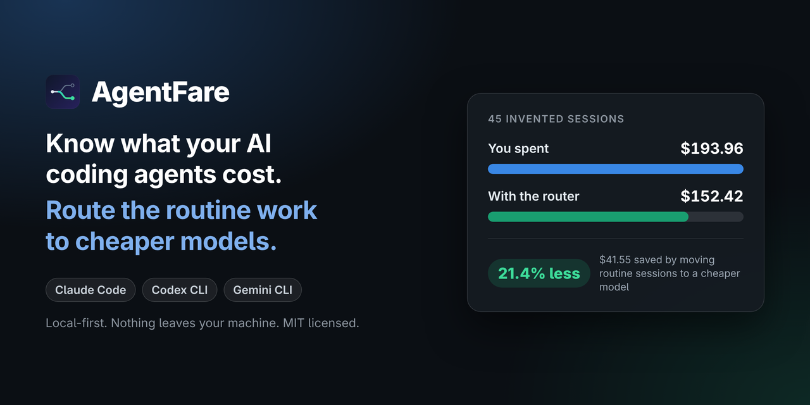
</p>

# AgentFare

Saiba quanto seus agentes de código com IA custam e onde um modelo mais barato teria dado conta do trabalho.

[](https://github.com/FernandoSLuz/agentfare/actions/workflows/ci.yml)
[](LICENSE)
[](pyproject.toml)
[](#requisitos-e-onde-o-agentfare-lê)
[](#privacidade)
[](https://www.buymeacoffee.com/fernandosluz)

[Início rápido](#início-rápido) | [Capturas de tela](#capturas-de-tela) | [Configuração](#configuração-em-60-segundos) | [Limitações](#limitações) | [FAQ](#perguntas-frequentes-e-solução-de-problemas)

O AgentFare lê os logs de sessão que o Claude Code, o Codex CLI e o Gemini CLI já gravam na sua máquina e calcula o preço de cada sessão a partir da contagem de tokens. Ele mostra onde um modelo mais barato provavelmente teria dado conta do trabalho e pode escolher um modelo para a sua próxima tarefa antes de você começá-la. As sessões ficam em um arquivo SQLite local, os preços em uma tabela YAML que você pode editar, e nada sai da sua máquina, exceto o `agentfare prices --refresh`, que é opcional.

Os preços dos tokens variam muito entre modelos. Na tabela de preços deste repositório, o `gpt-6-astra` custa US$ 10,00 por milhão de tokens de entrada e o `gpt-6-luna` custa US$ 0,10, uma diferença de 100 vezes. Um agente que fica no modelo mais caro em todas as tarefas paga essa taxa também nos trabalhos pequenos, então renomear uma variável custa o mesmo por token que projetar uma migração. Um relatório de gastos entrega o total. O AgentFare também estima quanto desse total um modelo mais barato provavelmente teria economizado. O `advise` olha para trás, sobre as suas sessões, e recalcula cada uma em um modelo mais barato quando ela parece pequena o bastante. O `run` olha para a frente: escolhe um modelo para uma tarefa a partir do prompt e do tamanho do repositório, mostra a escolha e uma estimativa de custo, e só inicia o seu agente depois de você confirmar. As economias são estimativas e o projeto está em alfa, então leia as [Limitações](#limitações) antes de agir com base em um número.

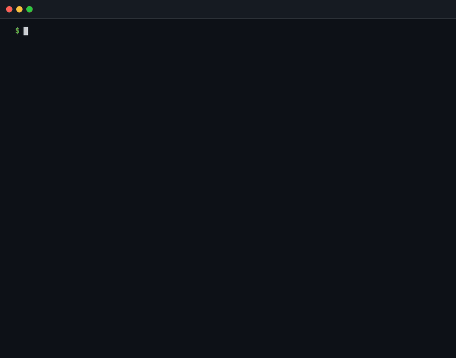

## Teste em 10 segundos

O `agentfare demo` roda o `summary` e o `advise` de verdade em 45 sessões inventadas que vêm dentro do pacote, então você não precisa de nenhum log seu. Ele nunca lê as pastas dos seus agentes nem o `~/.agentfare`, grava só em um diretório temporário e não abre nenhuma conexão de rede. A primeira linha da saída diz que os dados são sintéticos.

```sh
uvx --from git+https://github.com/FernandoSLuz/agentfare agentfare demo
```

O `uvx` vem com o uv ([como instalar o uv](https://docs.astral.sh/uv/getting-started/installation/)). Ele roda o AgentFare em um ambiente descartável e não instala nada. Com o AgentFare instalado (veja o [início rápido](#início-rápido)), o comando é `agentfare demo`:

```sh
agentfare demo                          # spend, top 3 pieces of advice, next steps
agentfare demo --keep ./agentfare-demo  # keep the invented data to explore it
agentfare demo --report week.html       # also write the report of the demo week
```

## Início rápido

São três passos: instalar, rodar o `agentfare init` uma vez e olhar sua conta e sua economia. Você precisa do Python 3.11 ou mais novo, de Linux ou macOS e de pelo menos um entre Claude Code, Codex CLI ou Gemini CLI com algum histórico.

### 1. Instale

O AgentFare ainda não está no PyPI, então todos os comandos abaixo o instalam a partir do GitHub, o que exige o git na sua máquina. O uv é o jeito mais rápido: ele mantém o AgentFare em um ambiente próprio, coloca o `agentfare` no seu PATH e consegue baixar um Python 3.11 ou mais novo quando o seu é mais antigo ([como instalar o uv](https://docs.astral.sh/uv/getting-started/installation/)).

```sh
uv tool install git+https://github.com/FernandoSLuz/agentfare
```

O pipx faz o mesmo trabalho:

```sh
pipx install git+https://github.com/FernandoSLuz/agentfare
```

Com o pip puro, use um ambiente virtual (muitos sistemas recusam uma instalação do pip em todo o sistema) e ative-o sempre que quiser rodar o AgentFare:

```sh
python3 -m venv ~/.venvs/agentfare
. ~/.venvs/agentfare/bin/activate
pip install git+https://github.com/FernandoSLuz/agentfare
```

Confira se ele roda:

```sh
agentfare --version
```

Se o shell responder `command not found`, a pasta que o instalador usa não está no seu PATH. O `uv tool update-shell` ou o `pipx ensurepath` resolve; depois abra um novo terminal. Até lá, rode `~/.local/bin/agentfare`, onde o uv e o pipx põem o comando por padrão. Com a instalação pelo pip, ative o ambiente dela ou rode `~/.venvs/agentfare/bin/agentfare`.

Quem contribui instala a partir de um clone. O [CONTRIBUTING.md](CONTRIBUTING.md) tem a configuração completa de desenvolvimento.

```sh
git clone https://github.com/FernandoSLuz/agentfare
cd agentfare
python3 -m venv .venv
. .venv/bin/activate
pip install -e .
```

Para atualizar, rode a linha que corresponde a como você instalou. Um banco de dados gravado por uma versão mais antiga é atualizado no próprio lugar na próxima vez que um comando o abrir.

```sh
uv tool upgrade agentfare
pipx upgrade agentfare
pip install --upgrade git+https://github.com/FernandoSLuz/agentfare
```

Para desinstalar:

```sh
uv tool uninstall agentfare
pipx uninstall agentfare
pip uninstall agentfare
```

Desinstalar deixa o `~/.agentfare` (seu banco de dados e sua configuração) onde está. O [FAQ](#perguntas-frequentes-e-solução-de-problemas) explica como apagá-lo.

O autocompletar com Tab fica desligado até você pedir. O `agentfare --install-completion` o instala para o seu shell atual editando os arquivos de inicialização desse shell, e o `agentfare --show-completion` imprime o script para você colocá-lo onde quiser. Nenhum outro comando mexe em arquivos do shell.

### 2. Configure com agentfare init

Rode uma vez. Ele encontra as pastas de logs dos três agentes, diz o que achou, lê os logs para um banco de dados local e imprime o seu total e a maior economia que enxerga. Em um histórico grande, a leitura leva cerca de um minuto.

```sh
agentfare init
```

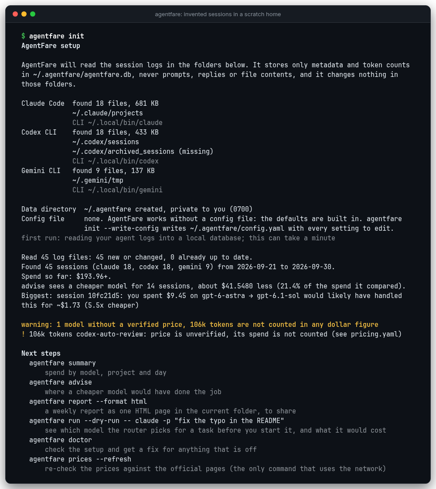

A captura é do `init` nas sessões inventadas da demo. A sua mostra as suas pastas e os seus números. Antes de ler qualquer coisa, o `init` imprime as pastas que vai olhar e diz que guarda só metadados e contagens de tokens, nunca prompts, respostas ou conteúdo de arquivos, e que não altera nada nessas pastas. Rodar de novo é seguro: só os logs novos ou alterados são lidos, e um arquivo de configuração existente nunca é sobrescrito.

```sh
agentfare init --dry-run        # only look, change nothing
agentfare init --write-config   # also write ~/.agentfare/config.yaml
agentfare doctor                # check the setup, get a fix for what is off
```

O AgentFare funciona sem arquivo de configuração, então o `--write-config` é opcional. Se o `init` não achar nenhuma sessão, ele avisa e aponta o `agentfare doctor` (o que está errado e como consertar), o `sources` na configuração (onde procurar quando o seu agente guarda os logs em outro lugar) e o `agentfare demo`.

### 3. Veja sua conta e sua economia

```sh
# spend by model, project and day
agentfare summary
# where a cheaper model would have done the job
agentfare advise
# the weekly report as one self-contained page
agentfare report --format html -o week.html
# the model the router picks for a task, without starting anything
agentfare run --dry-run -- claude -p "fix the typo in the README"
```

O `summary` soma o que você gastou. O `advise` lista as sessões em que um modelo mais barato provavelmente teria dado conta do trabalho, com um motivo de uma linha para cada uma. O `report` gera a página que você pode publicar ou guardar. O `run --dry-run` mostra o que o roteador escolheria para uma tarefa antes de você começá-la; sem o `--dry-run`, ele pede confirmação e depois inicia o seu agente com esse modelo. As [capturas de tela](#capturas-de-tela) mostram o que cada um imprime, e a [Configuração em 60 segundos](#configuração-em-60-segundos) cobre os ajustes que as pessoas mudam primeiro.

## Requisitos e onde o AgentFare lê

* Python 3.11 ou mais novo. A suíte de testes já rodou no 3.11, no 3.12 e no 3.14, e o CI cobre do 3.11 ao 3.14.
* Linux ou macOS. O CI roda em Ubuntu e macOS, e o autor só usou o AgentFare no Linux (veja as [Limitações](#limitações)).
* Um ou mais entre Claude Code, Codex CLI ou Gemini CLI, com histórico de sessões na mesma máquina. O `agentfare run` também precisa do comando do agente no seu PATH.
* Quatro dependências de execução: Typer, Rich, PyYAML e Jinja2. O banco de dados é o SQLite da biblioteca padrão do Python.

O AgentFare varre estas pastas, de forma recursiva:

| Agente | Pastas padrão | Movidas com |
|---|---|---|
| Claude Code | `~/.claude/projects` | `CLAUDE_CONFIG_DIR` (a pasta `projects` dele) |
| Codex CLI | `~/.codex/sessions` e `~/.codex/archived_sessions` | `CODEX_HOME` (`sessions` e `archived_sessions`) |
| Gemini CLI | `~/.gemini/tmp` | `GEMINI_CLI_HOME` (`.gemini/tmp` dentro dela) |

Uma entrada `sources:` na configuração substitui essas pastas para um agente ([Configuração em 60 segundos](#configuração-em-60-segundos)). Ele só lê arquivos e nunca altera nada nessas pastas. Os dados dele ficam em `~/.agentfare` (o `AGENTFARE_HOME` ou o `--home` movem essa pasta).

## Capturas de tela

Todas as imagens desta página vêm das 45 sessões inventadas do `agentfare demo`. Nenhuma é a gravação do trabalho de uma pessoa real.

### Para onde o dinheiro foi

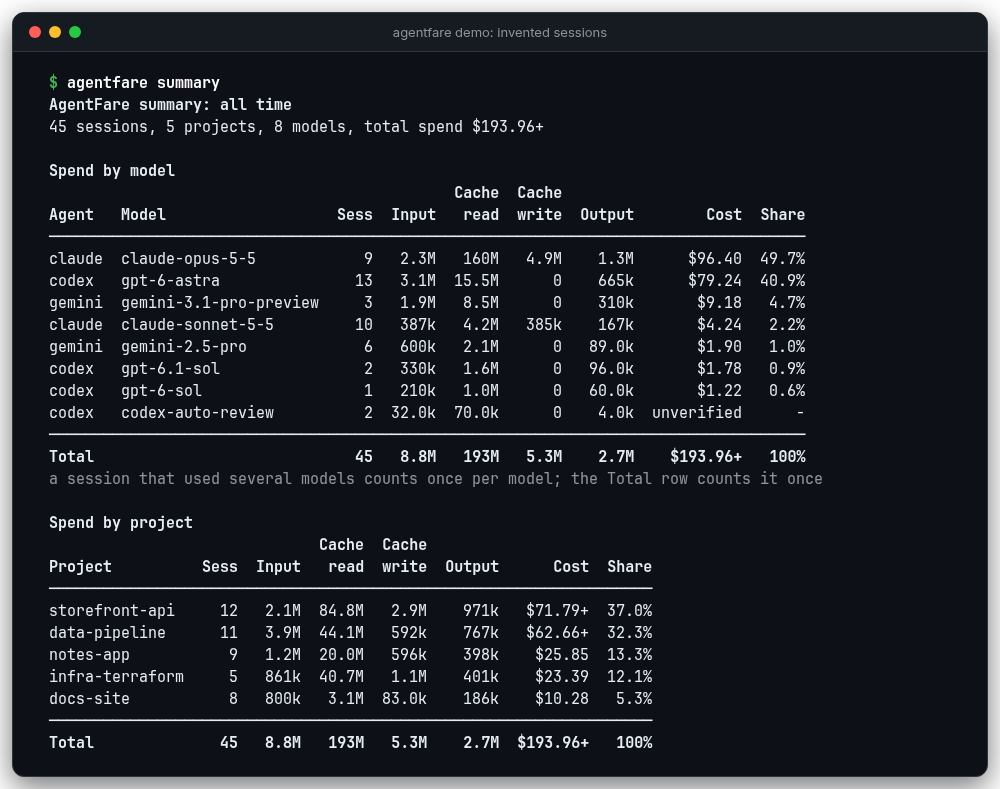

O `agentfare summary` soma o gasto por modelo, projeto e dia. Um modelo sem preço verificado fica fora do total, que então termina em `+`, e um aviso o nomeia.

### Onde um modelo mais barato teria dado conta

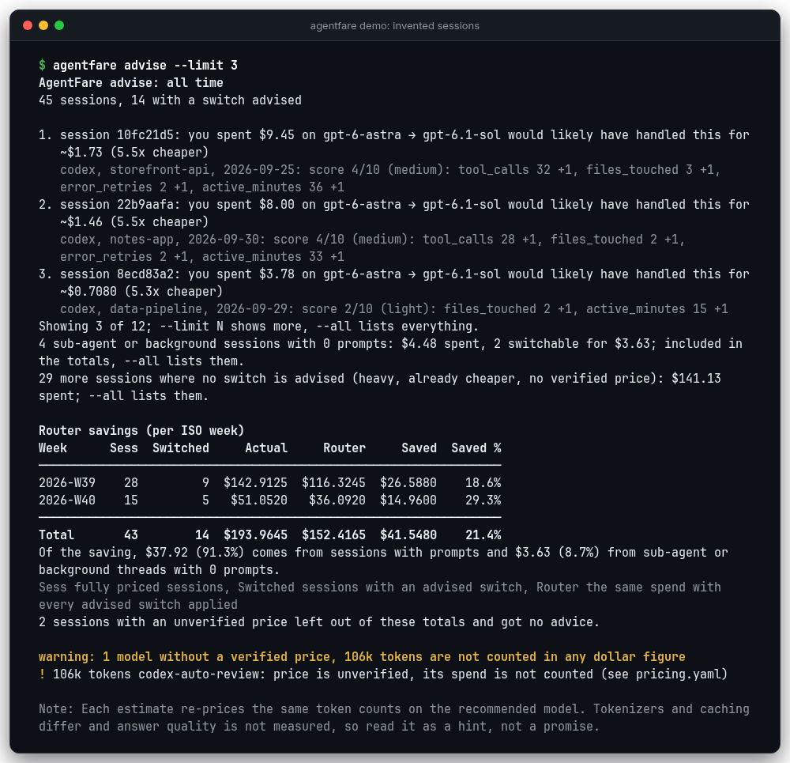

O `agentfare advise` recalcula cada sessão em um modelo mais barato quando o tamanho dela indica que isso é razoável e imprime o motivo em uma linha. A tabela no fim soma tudo por semana.

### Escolha um modelo antes de a tarefa começar

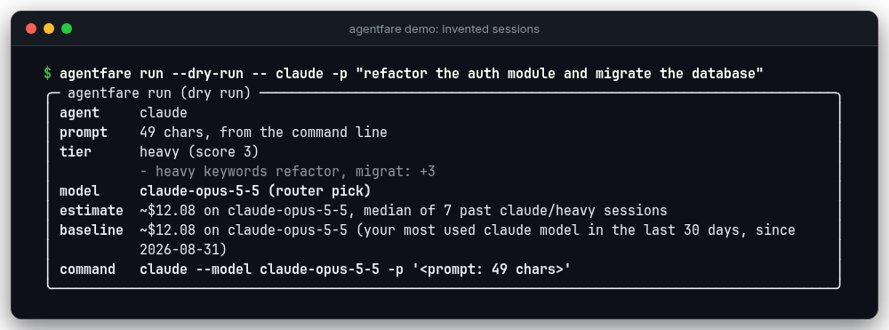

Uma tarefa pesada mantém o modelo pesado, e o painel mostra quais palavras e tamanhos decidiram. Uma tarefa leve passa para um modelo mais barato e mostra a economia estimada (há uma captura dela em Mais capturas de tela).

### O relatório semanal

O `agentfare report --format html` gera uma página autocontida, sem script e sem referência à rede. Ela segue o esquema de cores de quem a abre e tem um layout para celular. Os nomes de projeto aparecem como `Project A`, `Project B`, a menos que você passe `--show-projects`. Clique em uma imagem para vê-la em tamanho real.

<p>
  <a href="docs/images/report-dark.png">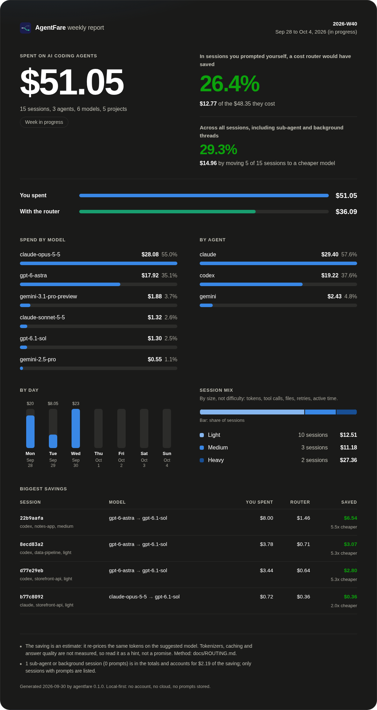</a>
  <a href="docs/images/report-light.png">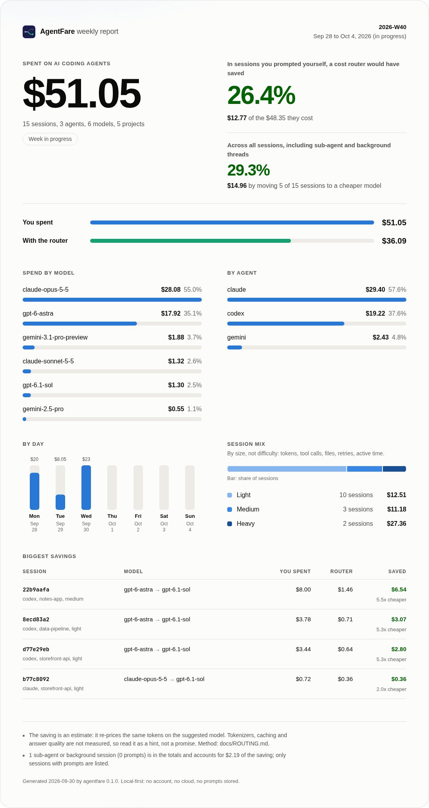</a>
</p>

<details>
<summary>O mesmo relatório em um celular</summary>

<p>
  <a href="docs/images/report-mobile.png">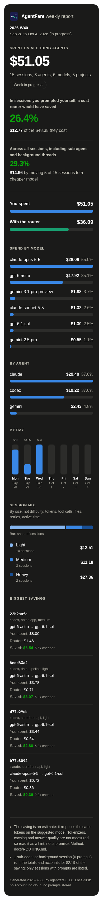</a>
</p>

</details>

<details>
<summary>Mais capturas de tela: uma tarefa leve, models, sessions e prices</summary>

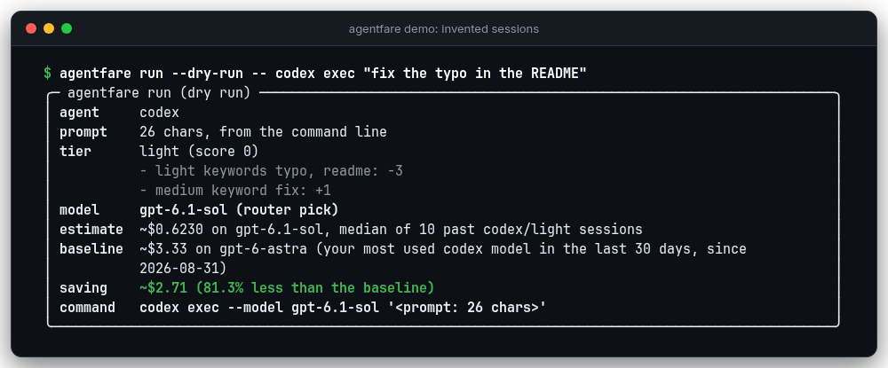

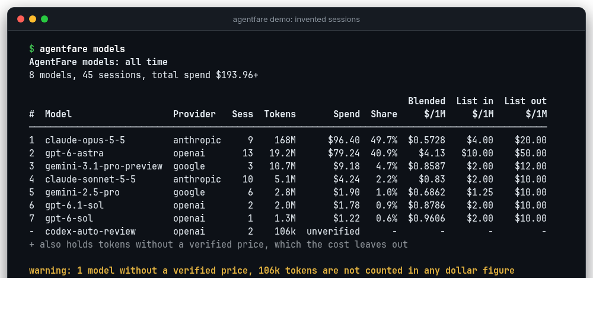

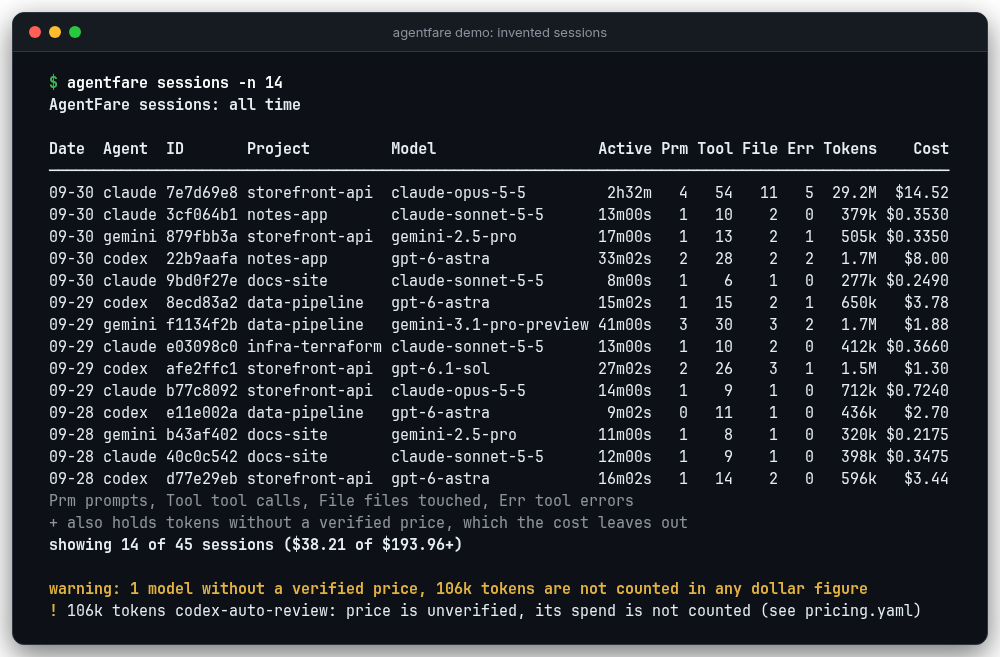

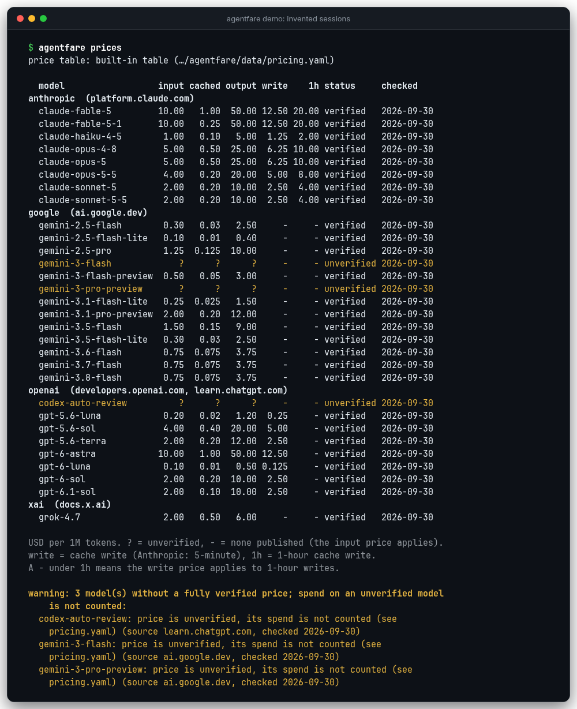

</details>

## O que você recebe

* Um comando, o `agentfare init`, encontra as pastas de logs dos seus agentes, lê tudo e imprime o seu total. O `agentfare doctor` confere a instalação, a configuração, as pastas, o banco de dados e os preços, e dá uma correção para cada linha que não está ok.
* Ele calcula o preço de cada sessão a partir da contagem de tokens, em microcentavos inteiros, usando uma tabela YAML que registra a página de origem e a data de cada preço. Você pode substituir qualquer preço.
* O dinheiro pertence ao momento em que foi gasto. Uma sessão que atravessa a meia-noite ou o limite de uma semana é dividida entre os dias e as semanas em que rodou, então `summary`, `sessions`, `models`, `advise` e `report` concordam para o mesmo período.
* O `advise` recalcula cada sessão passada em um modelo mais barato quando ela parece pequena o bastante, com os sinais por trás da decisão em uma linha. O `run` escolhe um modelo para a próxima tarefa e só inicia o seu agente depois de você confirmar. Os dois usam alguns limites que você pode ler e mudar na configuração, e nenhum usa um modelo de IA.
* Um relatório semanal em markdown do GitHub ou em uma página HTML autocontida, nos temas claro e escuro.
* Um modelo sem preço verificado fica fora de todo total em dólar e é nomeado em um aviso, então um total nunca esconde uma lacuna.
* `--json` em todo comando de relatório, com chaves estáveis e dinheiro como `{"cents": ..., "ucents": ...}`. A saída que não vai para um terminal não tem códigos de cor.
* Só local. As sessões vão para um arquivo SQLite, não existe telemetria, e o `agentfare prices --refresh` é o único comando que abre uma conexão.
* O `run` funciona com qualquer comando de agente, não só com os três cujos logs ele sabe ler. Adicione o seu em `agents:` na configuração.

## Como funciona


[O mesmo diagrama em SVG](docs/images/how-it-works.svg). Cada parser lê um arquivo de log linha por linha, ignora as linhas que não consegue ler e os tipos de registro que não conhece, remove as respostas que o agente registrou duas vezes e devolve um registro por sessão, com os tokens de cada resposta sob o horário dessa resposta. O [docs/ARCHITECTURE.md](docs/ARCHITECTURE.md) tem o mapa de módulos e as invariantes, e o [docs/LOG-FORMATS.md](docs/LOG-FORMATS.md) documenta cada formato de log.

### Privacidade

* O AgentFare guarda ids, nomes de projeto, horários, contagens de chamadas de ferramentas, de arquivos e de prompts, e contagens de tokens por modelo e por janela de 15 minutos.
* Ele nunca guarda, imprime nem inclui em relatórios prompts, respostas, entradas ou saídas de ferramentas, nem conteúdo de arquivos. Os testes dos parsers plantam uma sequência marcadora em todo campo de conteúdo dos logs de exemplo e falham se ela chegar a um registro de sessão, e o `tests/test_e2e_fixtures.py` procura essa sequência nos bytes brutos do diretório de dados depois de um ingest.
* Ele não abre nenhuma conexão de rede, exceto no `agentfare prices --refresh`. O `tests/test_no_network.py` garante isso com uma varredura do código-fonte e uma proteção em tempo de execução que bloqueia sockets enquanto todos os outros comandos rodam.
* Tudo o que ele cria é privado para você: diretórios novos são `0700` e arquivos novos são `0600`.
* Os relatórios escondem os nomes de projeto, a menos que você passe `--show-projects`, porque relatórios costumam ser publicados.

<details>
<summary>O que é guardado: as três tabelas, os caminhos de arquivo e as permissões</summary>

O banco de dados é um arquivo SQLite simples, com três tabelas:

| Tabela | Colunas |
|---|---|
| `sessions`, uma linha por sessão | `key`, `agent`, `session_id`, `project`, `started_at`, `ended_at`, `wall_seconds`, `active_seconds`, `tool_calls`, `files_touched`, `error_retries`, `turns`, `prompts`, `primary_model`, `source_path`, `ingested_at` |
| `session_usage`, uma linha por sessão, modelo e janela de 15 minutos | `key`, `model`, `slot`, `input`, `cache_read`, `cache_write`, `cache_write_1h`, `output` |
| `ingested_files`, para que logs sem mudança não sejam lidos de novo | `path`, `agent`, `signature`, `sessions` |

Prompts, respostas, entradas e saídas de ferramentas e conteúdo de arquivos nunca são copiados para um registro. `tool_calls`, `files_touched`, `error_retries`, `turns` e `prompts` são contagens, e `project` é o nome de um repositório ou diretório, nunca um caminho completo. Os testes dos parsers plantam uma sequência marcadora em todo campo de conteúdo dos logs de exemplo e garantem que ela nunca chega a um registro de sessão, e o `tests/test_e2e_fixtures.py` procura essa sequência nos bytes brutos do diretório de dados depois de um ingest.

`source_path` e `ingested_files.path` são os caminhos dos arquivos de log. No Claude Code, o nome da pasta nesse caminho é o diretório de trabalho codificado do projeto, então o banco de dados contém, sim, os nomes dos diretórios dos seus projetos. Os relatórios escondem os nomes de projeto, a menos que você passe `--show-projects`.

O diretório de dados é `~/.agentfare` (use `AGENTFARE_HOME` ou `--home` para movê-lo). O esquema do banco de dados tem versão em `PRAGMA user_version` (atualmente 3) e é atualizado no próprio lugar: um banco de uma versão mais antiga é reconstruído quando o próximo comando o abre, suas linhas antigas vão para a janela em que a sessão começou, e os logs são lidos de novo (o `ingested_files` é esvaziado) para que cada resposta caia na sua própria janela. Um banco gravado por uma versão mais nova é recusado com um erro e deixado como está, e um que não pode ser lido gera uma mensagem de erro com uma dica: apague o arquivo e a próxima execução o reconstrói a partir dos logs que ainda existirem.

O que o AgentFare cria é privado para você, seja qual for o seu `umask`: um diretório de dados novo é `0700` e um banco novo é `0600` (assim como os arquivos `-journal` e `-wal` dele), o `config --init` e um `pricing.yaml` novo gerado por `prices --refresh --write` são `0600`, e todo arquivo que o `report` grava também. Um diretório ou arquivo que já existe mantém a permissão que tem. Os arquivos são substituídos por meio de um arquivo temporário novo, e o nome padrão do relatório (`agentfare-report-<semana>.html`) é criado sem seguir um link simbólico plantado ali, de modo que um link não consegue redirecionar uma escrita. Um arquivo de configuração ou de preços cujos aliases YAML se expandem para mais de 100.000 valores é recusado com um erro em vez de ser carregado, e caracteres de controle ou sobreposições bidirecionais em um nome vindo de um log, de uma resposta de servidor ou de uma mensagem de erro aparecem como `?`. Um pipe nomeado entre os logs é ignorado, então uma varredura nunca trava nele. Um nome de projeto, id de sessão ou id de modelo vindo de um log é guardado com no máximo 200 caracteres (um nome mais longo mantém o início e termina em `...` e oito dígitos hexadecimais). Um arquivo de configuração ou de preços só é lido quando é um arquivo regular de no máximo 10 MB, e um `--prompt-file` de no máximo 2 MB, então `/dev/zero` ou um pipe nomeado termina em uma linha `error:` em vez de travar. Uma chave escrita duas vezes em um mapeamento de um arquivo de configuração ou de preços é um erro que nomeia a chave e a linha (`duplicate key input at line 5`).

</details>

<details>
<summary>Nenhuma rede, exceto um comando</summary>

Só o `agentfare prices --refresh` abre uma conexão. O `tests/test_no_network.py` garante isso de duas formas. Uma varredura estática falha quando qualquer módulo que não seja o `pricefetch.py` importa um módulo capaz de usar a rede ou esconde uma importação, e uma proteção em tempo de execução bloqueia sockets e a criação de processos enquanto todos os outros comandos rodam sobre os dados de exemplo. O `--refresh` nunca edita um preço: ele informa o que as páginas oficiais mostram e deixa a decisão com você.

</details>

### O dinheiro é atribuído a quando foi gasto

<details>
<summary>Como uma sessão que atravessa a meia-noite ou o limite de uma semana é dividida</summary>

Uma sessão pode durar horas ou dias, atravessando a meia-noite ou o limite de uma semana. O AgentFare não lança tudo no dia em que a sessão começou. Cada resposta tem o seu próprio horário, e os tokens dela vão para a janela UTC de 15 minutos em que esse horário cai (`2026-09-28T09:45:00Z` cobre de 09:45:00 a 09:59:59). Um dia ou uma semana ISO é então a soma das janelas dentro dele, convertida para o seu `timezone`. É por isso que `summary`, `sessions`, `models`, `advise` e `report` concordam para o mesmo período: um total é o dinheiro gasto dentro do período, não importa em que dia as sessões começaram.

Uma sessão que atravessa a borda de um período entra nesse período só com a sua parte. Ela conta como uma sessão ali (na coluna `Sess` do `summary`, na lista do `sessions`, na tabela semanal) e como uma sessão em um total que cobre os dois lados. Seus contadores (prompts, chamadas de ferramentas, arquivos tocados, tempo ativo) e a sua pontuação de complexidade continuam sendo da sessão inteira, porque descrevem a sessão, não o período. O `sessions` marca essa sessão com `*` e com `"clipped": true` no `--json`; o `advise` pontua a sessão pelo uso total dela e coloca em cada semana a parte do dinheiro que é dela. Uma resposta cujo registro não tem horário utilizável conta no horário em que a sessão começou.

</details>

### O dinheiro é um inteiro

<details>
<summary>Microcentavos, os cinco baldes de tokens e uma conta de exemplo</summary>

Todos os valores são microcentavos inteiros, em que um centavo equivale a 1.000.000 de microcentavos. Um preço é um número decimal de dólares por milhão de tokens, o custo de uma sessão é a soma, sobre cinco baldes de tokens, de tokens vezes preço, calculada com decimais exatos e arredondada para cima (metade para cima) uma única vez, e todo total é uma soma de inteiros, então números de ponto flutuante nunca tocam em um valor. A exibição mostra centavos inteiros a partir de US$ 1 (`$4.20`) e, abaixo de US$ 1, mostra duas casas decimais quando o valor é um centavo inteiro e quatro quando não é (`$0.0592`). O `--json` imprime cada valor como `{"cents": ..., "ucents": ...}`.

Cada parser mapeia os contadores do seu agente para os mesmos cinco baldes, de modo que o cálculo de preço nunca conta nada em dobro:

| Balde | O que guarda | Precificado em |
|---|---|---|
| `input` | Tokens de entrada sem cache | `input` |
| `cache_read` | Entrada servida pelo cache do prompt | `cached_input` (o preço de entrada quando a tabela não tem esse) |
| `cache_write` | Escritas no cache com a duração padrão de 5 minutos | `cache_write` (o preço de entrada quando a tabela não tem esse) |
| `cache_write_1h` | Escritas no cache com duração de 1 hora, que só o Claude Code registra | `cache_write_1h` (depois `cache_write`, depois `input`) |
| `output` | Tokens de saída, incluindo os tokens de raciocínio e de pensamento | `output` |

Para a sessão do Codex nos logs de exemplo (40.000 tokens de entrada sem cache, 60.000 em cache e 6.000 de saída no `gpt-6-astra`, a $10, $1 e $50 por milhão):

```
40,000 x $10 + 60,000 x $1 + 6,000 x $50 = $0.40 + $0.06 + $0.30 = $0.76 = 76,000,000 micro-cents
```

</details>

### Preços não verificados

Um preço que a página do provedor não confirmou aparece como a palavra `unverified` na tabela de preços. Um modelo cujo preço de entrada ou de saída é `unverified`, ou que nem está na tabela, fica fora de todo total em dólar: o total ganha um `+` no fim (por exemplo `$3.41+`), a célula de custo do modelo diz `unverified` (`unknown` quando o modelo não está na tabela), e um bloco `warning:` nomeia o modelo e quantos tokens não foram contados. Um modelo com preço de entrada e de saída verificados, mas com preço de entrada em cache ou de escrita em cache não verificado, ainda é contado, com esses tokens cobrados a uma taxa de reserva (o preço de entrada), e o aviso diz isso. O `advise` vai um passo além e não dá nenhum conselho sobre uma sessão que tenha qualquer uso sem preço, porque uma porcentagem economizada sobre metade de uma sessão não significaria nada. O `agentfare prices --unverified` lista as linhas afetadas.


## Configuração em 60 segundos

O AgentFare funciona sem arquivo de configuração. Para mudar algo, grave o arquivo com todos os padrões e seus comentários e depois edite-o:

```sh
agentfare config --init   # write ~/.agentfare/config.yaml with every default
agentfare config          # show the files and log folders in use
```

O `agentfare init --write-config` grava o mesmo arquivo. Estes seis ajustes são os que as pessoas mudam primeiro. Cada trecho mostra uma chave como ela deve ficar no arquivo. O arquivo já tem todas essas chaves, então altere as linhas que estão lá e não cole uma segunda cópia: uma chave que aparece duas vezes é um erro que nomeia a chave e a linha (`duplicate key sources at line 86`). Uma chave que você apaga volta ao padrão, então um arquivo só com as chaves que você muda já está completo. Uma chave que não existe (um erro de digitação) gera um aviso que nomeia a chave e diz o que você provavelmente quis dizer.

1. Onde ficam os seus logs, quando um agente os guarda fora da pasta padrão. O valor é uma lista de pastas para aquele agente, e os outros agentes mantêm os padrões:

   ```yaml
   sources:
     claude: [~/work-logs/claude/projects]
   ```

2. O fuso horário que decide a qual dia e a qual semana ISO uma sessão pertence. O padrão é `local`:

   ```yaml
   timezone: America/Toronto
   ```

3. O intervalo de inatividade. Uma pausa mais longa que isso não conta como tempo ativo da sessão. Mudá-lo faz a próxima execução ler todos os logs de novo:

   ```yaml
   idle_gap_minutes: 15
   ```

4. Com o que o `advise` compara e quanta certeza ele precisa ter. Este exemplo compara as sessões leves e médias com o `claude-sonnet-5-5`, mantém as pesadas, só recomenda uma troca quando ela é pelo menos duas vezes mais barata e só lista uma sessão em linha própria acima de 25 centavos:

   ```yaml
   router:
     recommend: {light: claude-sonnet-5-5, medium: claude-sonnet-5-5, heavy: null}
     min_saving_ratio: 2
     advise: {min_cost_cents: 25}
   ```

   O modelo recomendado precisa estar na tabela de preços com um preço verificado. Os limites dos sinais e os cortes dos níveis também ficam em `router` (veja [Como o roteador decide](#como-o-roteador-decide)).

5. Preços. Um arquivo em `~/.agentfare/pricing.yaml` substitui a tabela embutida, e o `pricing_file` aponta para outro caminho:

   ```yaml
   pricing_file: ~/prices/my-prices.yaml
   ```

   [Substituindo preços](#substituindo-preços) mostra como começar de uma cópia da tabela embutida.

6. Os agentes que o `agentfare run` conhece. Adicione um comando em `agents:` e dê a ele um modelo para cada nível:

   ```yaml
   agents:
     aider: {commands: [aider], model_flag: "--model"}
   router:
     run:
       models:
         aider: {light: claude-sonnet-5-5, medium: claude-sonnet-5-5, heavy: claude-opus-5-5}
   ```

[Todas as chaves de configuração](#todas-as-chaves-de-configuração) lista o resto, com o padrão de cada uma e o que ela faz.

## Referência de comandos

As saídas abaixo vêm das três sessões sintéticas em [`tests/fixtures/`](tests/fixtures/) (uma por agente), impressas com `COLUMNS=100`. Elas são pequenas o bastante para serem conferidas à mão e não são as sessões inventadas das capturas de tela. [Reproduza estas saídas](#reproduza-estas-saídas) mostra como obtê-las na sua máquina, e um teste falha quando elas se afastam da saída real. Cada valor em dólar é calculado à mão, token por token, em [`tests/fixtures/EXPECTED.md`](tests/fixtures/EXPECTED.md).

### Todos os comandos

```sh
agentfare init                          # find your logs, read them, show the total
agentfare doctor                        # check the setup, get a fix for each problem
agentfare demo                          # try it on 45 invented sessions
agentfare ingest                        # scan the logs now (--json: as data)
agentfare summary                       # spend by model, project and day
agentfare summary --week                # only the current ISO week
agentfare summary --since 2026-09-01    # from that day on (--until ends a range)
agentfare summary --project acme-shop   # one project, matched in any case
agentfare summary --top 5               # the 5 biggest projects and 5 latest days
agentfare sessions --sort cost -n 10    # the ten dearest sessions
agentfare models                        # ranking with effective and list price
agentfare advise                        # where a cheaper model would have done it
agentfare advise --all                  # every session, also those in the totals
agentfare report --format md            # the weekly report as markdown on stdout
agentfare report --format html -o week.html
agentfare run --dry-run -- claude -p "fix the typo in the README"
agentfare config --init                 # write ~/.agentfare/config.yaml
```

<details>
<summary>Períodos, filtros e terminais estreitos</summary>

O cabeçalho de todo relatório nomeia o seu período: `all time`, `week 2026-09-28 .. 2026-10-04`, `from 2026-09-01`, `up to 2026-09-30` ou `2026-09-01 .. 2026-09-30`. Os dias são escritos `YYYY-MM-DD` e seguem o seu `timezone`, e uma visão por período contém o dinheiro gasto dentro dele, o que `summary` e `models` dizem sob o cabeçalho. `--agent claude` (ou `codex`, `gemini`) mantém um agente. Quando o `--project` não corresponde a nenhum projeto, o resultado vazio lista os nomes que começam com ele ou o contêm, depois os que se escrevem quase como ele (ou os seus maiores projetos), em vez de só dizer que nada foi encontrado. A correspondência ignora maiúsculas e minúsculas e as tabelas listam os nomes como estão escritos, então `work` e `Work` são duas linhas que o `--project work` encontra juntas.

O `summary --top N` (10 por padrão) mostra os N maiores projetos e os N dias mais recentes e dobra o resto em uma linha como `2 more (total $0.98)`. Ele só dobra quando isso esconde pelo menos duas linhas, o título da tabela então diz `(top 5 by spend)` ou `(latest 5 days)`, o `--top 0` lista todas as linhas, e o `--json` sempre lista. As tabelas são feitas para 80 colunas. Em um terminal mais estreito, o nome de um modelo ou projeto é cortado no fim com reticências, nunca para o mesmo texto de outra linha, depois as colunas menos úteis são omitidas com uma linha que diz quais (o `--json` tem tudo), e nenhum número é cortado.

</details>

### Lendo os logs

Todo comando que lê dados varre os logs antes quando algo mudou, então você raramente precisa iniciar uma varredura por conta própria.

<details>
<summary>Como a varredura funciona, <code>agentfare ingest</code> e <code>--no-ingest</code></summary>

O primeiro comando que precisa de dados varre `~/.claude/projects`, `~/.codex/sessions`, `~/.codex/archived_sessions` e `~/.gemini/tmp` e preenche o banco de dados. Se você mudou o diretório de dados de um agente, a variável de ambiente própria do agente é seguida: `CLAUDE_CONFIG_DIR` (a pasta `projects` dele), `CODEX_HOME` (`sessions` e `archived_sessions`) e `GEMINI_CLI_HOME` (`.gemini/tmp` dentro dela). Uma entrada `sources:` na configuração as substitui. Em um histórico grande, essa primeira varredura leva cerca de um minuto, e isso é dito no stderr: `first run: reading your agent logs into a local database; this can take a minute`. Um agente cuja varredura passa de dois segundos acrescenta `still reading <agent> logs...` uma vez. As execuções seguintes processam só os arquivos que mudaram, e todos os arquivos de novo quando você muda o `idle_gap_minutes` ou instala uma versão que lê os logs de outro jeito, para que os números nunca descrevam ajustes antigos. Quando uma varredura gravou algo, o comando de relatório imprime `ingested 3 new/updated sessions` no stderr antes das suas tabelas.

O `agentfare ingest` roda a varredura sozinho (`--full` lê tudo de novo, `--agent claude` varre um agente, `--json` imprime o resultado como dados) e diz o que fez, por exemplo `read 12 session records from 14 files (14 parsed, 0 unchanged); the database holds 11 distinct sessions`. Uma sessão encontrada em mais de um arquivo, digamos um log arquivado e a cópia ativa dele, é guardada uma vez, a partir da cópia com mais tokens, e um aviso conta essas sessões: `1 session appears in more than one log file; the copy with the most tokens was kept`. Um log que não pode ser lido é nomeado no stderr com o erro do sistema operacional (`PermissionError: Permission denied`), a varredura continua com os outros arquivos, e a última linha do `ingest` diz quantos arquivos falharam. O objeto do `--json` tem as chaves `files_seen`, `files_parsed`, `files_unchanged`, `sessions_read` (registros), `sessions_stored` (sessões distintas gravadas por esta execução), `by_agent`, `database` (`path` e `sessions`, todas as sessões distintas que ele guarda), `missing_roots`, `errors`, `files_failed` e `duplicate_sessions`.

O `--no-ingest` global pula a varredura e abre um banco de dados existente da versão atual somente para leitura, de modo que um arquivo em que você não pode gravar ainda responde. Em um banco que acabou de ser atualizado e ainda não foi relido, ele diz uma vez no stderr `database upgraded: day and week splits are approximate until agentfare ingest has re-read your logs`. Se o banco não tem nenhuma sessão, um resultado vazio aponta o `agentfare ingest` e o `agentfare config`, que lista os diretórios de log em que ele procura e marca os que faltam. Caso contrário, ele diz quais datas têm dados, por exemplo `data exists from 2026-08-01 to 2026-09-30`.

</details>

### Exemplos de saída

<details>
<summary><code>agentfare summary</code> calcula o preço das sessões e as soma por modelo, projeto e dia</summary>

<!-- run: agentfare summary -->
```
AgentFare summary: all time
3 sessions, 3 projects, 4 models, total spend $3.63

Spend by model
                                       Cache  Cache
Agent   Model             Sess  Input   read  write  Output     Cost  Share
───────────────────────────────────────────────────────────────────────────
claude  claude-opus-5-5      1  39.2k   3.1M   155k   42.9k    $2.59  71.4%
codex   gpt-6-astra          1  40.0k  60.0k      0    6.0k    $0.76  20.9%
gemini  gemini-2.5-pro       1  92.0k  80.0k      0    9.5k    $0.22   6.1%
claude  claude-haiku-4-5     1   4.7k   120k  18.0k    2.2k  $0.0592   1.6%
───────────────────────────────────────────────────────────────────────────
Total                        3   176k   3.3M   173k   60.6k    $3.63   100%
a session that used several models counts once per model; the Total row counts it once

Spend by project
                             Cache  Cache
Project         Sess  Input   read  write  Output   Cost  Share
───────────────────────────────────────────────────────────────
acme-shop          1  43.9k   3.2M   173k   45.1k  $2.65  73.0%
fake-repo          1  40.0k  60.0k      0    6.0k  $0.76  20.9%
demo-notes-app     1  92.0k  80.0k      0    9.5k  $0.22   6.1%
───────────────────────────────────────────────────────────────
Total              3   176k   3.3M   173k   60.6k  $3.63   100%

Spend by day
                         Cache  Cache
Day         Sess  Input   read  write  Output   Cost  Share
───────────────────────────────────────────────────────────────────────
2026-09-28     1  43.9k   3.2M   173k   45.1k  $2.65  73.0%  ██████████
2026-09-29     1  40.0k  60.0k      0    6.0k  $0.76  20.9%  ███
2026-09-30     1  92.0k  80.0k      0    9.5k  $0.22   6.1%  █
───────────────────────────────────────────────────────────────────────
Total          3   176k   3.3M   173k   60.6k  $3.63   100%
```

</details>

<details>
<summary><code>agentfare advise</code> compara cada sessão com um modelo mais barato</summary>

<!-- run: agentfare advise -->
```
AgentFare advise: all time
3 sessions, 1 with a switch advised

1. session 7c8d9e0f: you spent $0.76 on gpt-6-astra → gpt-6.1-sol would likely have handled this for
   ~$0.1460 (5.2x cheaper)
   codex, fake-repo, 2026-09-29: score 2/10 (light): files_touched 2 +1, active_minutes 10 +1
2 more sessions where no switch is advised (heavy, already cheaper, no verified price): $2.87 spent;
--all lists them.

Router savings (per ISO week)
Week      Sess  Switched   Actual   Router    Saved  Saved %
────────────────────────────────────────────────────────────
2026-W40     3         1  $3.6310  $3.0170  $0.6140    16.9%
────────────────────────────────────────────────────────────
Total        3         1  $3.6310  $3.0170  $0.6140    16.9%
Of the saving, $0.6140 (100%) comes from sessions with prompts and $0.00 (0.0%) from sub-agent or
background threads with 0 prompts.
Sess fully priced sessions, Switched sessions with an advised switch, Router the same spend with
every advised switch applied

Note: Each estimate re-prices the same token counts on the recommended model. Tokenizers and caching
differ and answer quality is not measured, so read it as a hint, not a promise.
```

A sessão do Codex custou $0.76 no `gpt-6-astra`. Os mesmos tokens no `gpt-6.1-sol` custam $0.146, ou seja, 5,2 vezes menos, então o `advise` sugere a troca. A sessão do Claude Code teve pontuação 7 de 10 (pesada) e é mantida como está, e a sessão do Gemini CLI já custa menos que o `gpt-6.1-sol`. A tabela semanal soma tudo: $0.614 de $3.63, ou 16,9%, e a linha abaixo dela diz quanto disso veio de sessões que você iniciou e quanto veio de threads de subagente ou de segundo plano. Cada valor recalcula os mesmos tokens em outro modelo. Se esse modelo teria dado conta do trabalho não é medido (veja as [Limitações](#limitações)).

</details>

<details>
<summary><code>agentfare sessions</code> lista uma linha por sessão, a mais recente primeiro</summary>

Os contadores são prompts, chamadas de ferramentas, arquivos tocados e erros de ferramentas, e um `+1` depois do modelo significa que a sessão usou mais um modelo. Em uma visão por período (`--week`, `--since`, ...), uma sessão que atravessa a borda do período mostra só o que gastou dentro dele, e um `*` depois do custo avisa isso:

<!-- run: agentfare sessions -->
```
AgentFare sessions: all time

Date  Agent  ID       Project        Model              Active Prm Tool File Err Tokens  Cost
─────────────────────────────────────────────────────────────────────────────────────────────
09-30 gemini 4a6e8f10 demo-notes-app gemini-2.5-pro      9m55s   3    7    2   1   182k $0.22
09-29 codex  7c8d9e0f fake-repo      gpt-6-astra        10m00s   1    5    2   1   106k $0.76
09-28 claude a1c7e402 acme-shop      claude-opus-5-5 +1  1h38m   5   46   10   5   3.5M $2.65
Prm prompts, Tool tool calls, File files touched, Err tool errors
showing 3 of 3 sessions, total $3.63
```

</details>

<details>
<summary><code>agentfare models</code> ordena os modelos por gasto</summary>

Ele coloca o preço que você efetivamente pagou por milhão de tokens ao lado do preço de tabela:

<!-- run: agentfare models -->
```
AgentFare models: all time
4 models, 3 sessions, total spend $3.63

                                                              Blended  List in  List out
#  Model             Provider   Sess  Tokens    Spend  Share     $/1M     $/1M      $/1M
────────────────────────────────────────────────────────────────────────────────────────
1  claude-opus-5-5   anthropic     1    3.3M    $2.59  71.4%  $0.7813    $4.00    $20.00
2  gpt-6-astra       openai        1    106k    $0.76  20.9%    $7.17   $10.00    $50.00
3  gemini-2.5-pro    google        1    182k    $0.22   6.1%    $1.21    $1.25    $10.00
4  claude-haiku-4-5  anthropic     1    145k  $0.0592   1.6%  $0.4086    $1.00     $5.00
```

</details>

<details>
<summary><code>agentfare run --dry-run</code> mostra a decisão do roteador sem iniciar nada</summary>

Sem o `--dry-run`, o mesmo painel vai para o stderr, você confirma, e o agente inicia com o modelo escolhido:

<!-- run: agentfare run --dry-run -- claude -p "fix the typo in the README" -->
```
╭─ agentfare run (dry run) ────────────────────────────────────────────────────────────────────────╮
│ agent     claude                                                                                 │
│ prompt    26 chars, from the command line                                                        │
│ tier      light (score 0)                                                                        │
│           - light keywords typo, readme: -3                                                      │
│           - medium keyword fix: +1                                                               │
│ model     claude-sonnet-5-5 (router pick)                                                        │
│ estimate  ~$0.3125 on claude-sonnet-5-5, typical light task (no history yet)                     │
│ baseline  ~$0.5050 on claude-opus-5-5 (your most used claude model in the last 30 days, since    │
│           2026-08-31)                                                                            │
│ saving    ~$0.1925 (38.1% less than the baseline)                                                │
│ command   claude --model claude-sonnet-5-5 -p '<prompt: 26 chars>'                               │
╰──────────────────────────────────────────────────────────────────────────────────────────────────╯
```

</details>

### O relatório semanal

O relatório semanal é markdown do GitHub ou uma página HTML autocontida.

<details>
<summary>Opções, privacidade dos nomes de projeto e como a manchete é redigida</summary>

O `--format md` imprime markdown do GitHub e o `--format html` grava uma página autocontida, sem script e sem referência à rede (o `-o -` imprime qualquer um dos dois no stdout em vez de gravar um arquivo). O `--week-of 2026-W39` escolhe a semana (o padrão é a última semana com gasto), e os nomes de projeto aparecem como `Project A`, `Project B`, a menos que você passe `--show-projects`, porque relatórios costumam ser publicados. A manchete abre com a economia nas sessões que você mesmo iniciou: `In sessions you prompted yourself, a cost router would have saved 16.9% ($0.61) of the $3.63 they cost`. Esse é o número para citar, porque você escolheu o modelo dessas sessões. O número de todas as sessões vem em segundo lugar e é rotulado como incluindo threads de subagente e de segundo plano, cujo modelo ninguém escolheu. Quando algumas sessões só têm preço parcial (um modelo sem preço verificado), cada porcentagem informa a sua base, por exemplo `of the $48.00 that could be compared`, e quando nenhuma das sessões que você iniciou pôde ser comparada, o relatório diz isso e dá apenas o número de todas as sessões. Uma semana que ainda não terminou diz `Week in progress` em vez de uma variação percentual em relação à última.

</details>

### Reproduza estas saídas

As saídas acima precisam de um diretório de dados descartável, de um relógio congelado e da configuração dos dados de exemplo. Rode isto a partir do clone:

```sh
export AGENTFARE_HOME=$(mktemp -d)
export AGENTFARE_NOW=2026-09-30T12:00:00Z
export AGENTFARE_CONFIG=$PWD/tests/fixtures/config.yaml
export COLUMNS=100
agentfare summary
```

O exemplo do `run` conta os arquivos sob o diretório atual, então comece por um diretório pequeno. O clone em si tem mais de 200 arquivos, que é onde a regra de tamanho do repositório começa a somar pontos, e o painel ganharia uma linha `repo has ... files`. Rodar `cd "$(mktemp -d)"` antes do `agentfare run` resolve, porque o `AGENTFARE_CONFIG` é um caminho absoluto. O `run` só lê o banco de dados e nunca o cria, então rode o `agentfare summary` (ou o `ingest`) primeiro, como acima, para dar a ele o histórico em que o painel mostrado neste README se baseia. O `bash scripts/demo.sh` roda o passeio completo com os mesmos ajustes.

## Usando com qualquer agente

O `agentfare run` envolve qualquer comando de agente. Tudo depois de `--` é o comando, repassado sem alteração, exceto por uma flag de modelo acrescentada:

```sh
agentfare run -- claude -p "refactor the billing module"
agentfare run -- codex exec "rename the helper in notes.py"
agentfare run -- gemini -p "add a docstring to parse()"
agentfare run --prompt-file task.md -- claude       # a prompt the command line lacks
agentfare run --force-model claude-opus-5-5 -- claude
agentfare run --yes -- claude -p "fix the typo"     # no question, for no terminal
```

<details>
<summary>O que o run imprime, como pergunta, como esconde argumentos e os seus códigos de saída</summary>

O painel de decisão vai para o stderr, então a saída do próprio agente continua limpa, e o `--dry-run` o imprime no stdout e para (o `--dry-run --json` o imprime como dados). O `run` nunca lê os seus logs e nunca cria o banco de dados, então é instantâneo: ele só lê o histórico que um `ingest`, um `summary` ou outro comando de relatório anterior gravou, o que significa que a estimativa e a base de comparação dele usam a última varredura. O `run` nunca inicia um agente antes de mostrar a decisão. Em um terminal, ele pergunta `Run this?`, e sem terminal precisa do `--yes`: caso contrário, imprime um erro, não inicia nada e sai com o código 3. O prompt é mostrado como o seu comprimento e nunca como texto, e o mesmo vale para todos os outros argumentos, porque uma flag pode conter um segredo (`--api-key sk-...`): só são mostrados o programa, as palavras de subcomando que ele conhece (`exec`, `resume`, `mcp`, ...), a flag de modelo com o seu valor e os nomes das flags, e o resto aparece como `<arg: N chars>`. O agente continua recebendo todos os argumentos sem alteração. O agente inicia com o próprio stdin, stdout e stderr e recebe `AGENTFARE_TIER` e `AGENTFARE_MODEL` no seu ambiente.

Se o comando já seleciona um modelo (`claude --model ...`), essa escolha vence e a escolha do roteador é só uma sugestão. Indicar um modelo diferente com o `--force-model` é um erro de uso. Quando a linha de comando não traz um prompt, como em uma sessão interativa, as regras de prompt são puladas com uma nota, e o `--prompt` ou o `--prompt-file` as adiciona.

| Código de saída | Significado |
|---|---|
| o próprio código do agente | O agente rodou. Uma morte pelo sinal N dá 128 + N |
| 1 | Você respondeu não em `Run this?` |
| 2 | Erro de uso ou de configuração |
| 3 | O stdin não é um terminal e não há `--yes`, então nada foi iniciado |
| 126 | O comando não pode ser executado |
| 127 | O comando não foi encontrado |

</details>

### Agentes personalizados

Qualquer comando pode ser roteado. Adicione-o em `agents:` e dê modelos a ele em `router.run.models`. Os comandos dele são comparados pelo nome base, e `model_flag` é a opção que recebe um modelo:

```yaml
agents:
  aider: {commands: [aider], model_flag: "--model"}
router:
  run:
    models:
      aider: {light: claude-sonnet-5-5, medium: claude-sonnet-5-5, heavy: claude-opus-5-5}
```

```sh
agentfare run --prompt "rename the helper" -- aider
```

O `--model-flag FLAG` nomeia a opção que recebe um modelo em uma única execução, no lugar do `model_flag` da configuração. Só a sintaxe de prompt do Claude Code, do Codex CLI e do Gemini CLI é entendida, então um agente personalizado precisa do `--prompt` ou do `--prompt-file` para que as regras de prompt valham. Sem modelos para o seu nome, ele roda sem alteração e com um aviso. Os logs de agentes personalizados não são lidos pelo ingest, porque a leitura precisa de um parser: o [docs/LOG-FORMATS.md](docs/LOG-FORMATS.md#adding-an-agent) mostra como adicionar um.

### Scripts e CI

`ingest`, `summary`, `sessions`, `models`, `advise`, `report`, `prices` e `run --dry-run` aceitam `--json` (o `report --json` não pode ser combinado com `--format html`). Todo valor é `{"cents": ..., "ucents": ...}`, as participações são pontos-base inteiros, e as chaves são estáveis. A saída que não vai para um terminal não tem códigos de cor, e as notas de andamento vão para o stderr. Os exemplos usam o `jq`, uma ferramenta à parte que talvez você precise instalar.

```sh
agentfare summary --week --json | jq '.total.cents'
agentfare advise --json | jq '.total.saved.cents'
agentfare --no-ingest sessions --all --json > sessions.json   # database as it is

spent=$(agentfare summary --week --json | jq .total.cents)
[ "$spent" -le 5000 ] || { echo "agent spend this week is over \$50" >&2; exit 1; }
```

<details>
<summary>Erros, códigos de saída e opções para scripts</summary>

Problemas de configuração (uma configuração, tabela de preços ou banco de dados ilegível, um ajuste inválido como um `idle_gap_minutes` não numérico, uma data ou um valor de filtro inválido) imprimem uma linha `error: ...` e saem com o código 2, com ou sem `--no-ingest`. Um banco de dados gravado por uma versão mais nova é recusado do mesmo modo. Uma opção desconhecida, ou um valor que o próprio analisador de opções verifica, como `--format pdf`, também sai com 2 e imprime a mensagem de uso do analisador; uma opção global digitada depois do comando, como em `agentfare summary --no-ingest`, recebe como resposta o lugar onde ela vai (`agentfare --no-ingest summary`). `-h` é abreviação de `--help`. O `agentfare prices --refresh` sai com 1 quando nenhum modelo pôde ser conferido.

</details>

| Ajuste | Efeito |
|---|---|
| `--config FILE` ou `AGENTFARE_CONFIG` | Usa este arquivo de configuração em vez de `~/.agentfare/config.yaml` |
| `--home DIR` ou `AGENTFARE_HOME` | Usa este diretório de dados em vez de `~/.agentfare` |
| `AGENTFARE_NOW` | Congela a data de hoje (ISO 8601), para demos e testes |
| `--no-ingest` | Pula a varredura dos logs e usa o banco de dados como está |


## Como o roteador decide

O roteador não tem modelo de IA nem aprendizado. São alguns limites em `router:` no `config.yaml`, aritmética de inteiros e uma linha de explicação por decisão, e ele lê contadores e comprimentos, nunca texto. Esta seção traz todas as regras e todos os padrões. O [docs/ROUTING.md](docs/ROUTING.md) tem as tabelas completas e a história de como os padrões foram calibrados.

### `advise`: olhando para trás

Cada sessão recebe uma pontuação de 0 a 10 em cinco sinais que os parsers já extraem: tokens de entrada, chamadas de ferramentas, arquivos tocados, repetições por erro e minutos ativos. A pontuação escolhe um nível (leve, médio ou pesado), e uma sessão leve ou média é recalculada em um modelo mais barato. Uma troca só é recomendada quando ela é pelo menos 1,2 vez mais barata.

<details>
<summary>Sinais, limites e níveis</summary>

Cada sessão é medida em cinco sinais que os parsers já extraem. Um sinal vale 0 ponto abaixo do limite `medium`, 1 ponto a partir de `medium` e 2 pontos a partir de `heavy` (a comparação é `>=`), então uma sessão pontua de 0 a 10:

<!-- generated: signals -->

| Signal | What it counts | 1 point from | 2 points from |
|---|---|---|---|
| `router.signals.input_tokens` | Every input token of the session, all models added up: uncached, cache reads and cache writes. Output tokens are left out. | 2,000,000 | 25,000,000 |
| `router.signals.tool_calls` | Tool invocations: reading, searching, editing and running commands. | 25 | 180 |
| `router.signals.files_touched` | Distinct files written or edited. A count, never names. | 1 | 6 |
| `router.signals.error_retries` | Tool calls that came back as an error. | 2 | 8 |
| `router.signals.active_minutes` | Active seconds divided by 60. Pauses longer than `idle_gap_minutes` do not count. | 10 | 80 |

<!-- /generated -->

A pontuação escolhe um nível:

<!-- generated: tiers -->

| Score | Tier |
|---|---|
| 0 to 2 | light |
| 3 to 6 | medium |
| 7 to 10 | heavy |

The cuts are `router.tiers`: `light_max: 2` and `medium_max: 6`.

<!-- /generated -->

Todo sinal conta igual. Para fazer um deles pesar menos, aumente os limites dele, e para desligá-lo ponha os dois acima de qualquer coisa que você vá ver. Não há pesos para ajustar. Os padrões são os tercis arredondados de 470 sessões reais com prompts de uma máquina (Claude Code e Codex CLI), então cerca de um terço das sessões cai em cada faixa de pontuação por sinal.

</details>

<details>
<summary>A regra de recomendação, o que o advise lista e um exemplo calculado</summary>

O `router.recommend` mapeia cada nível ao modelo de comparação: `gpt-6.1-sol` para `light` e `medium`, e `null` para `heavy`, que mantém o que você usou. O uso completo da sessão, todos os modelos somados, é recalculado nesse modelo balde por balde, com as taxas próprias dele. Uma troca só é recomendada quando o novo custo é pelo menos `router.min_saving_ratio` (1.2) vez menor. A comparação usa inteiros exatos, então uma sessão que é exatamente 1,2 vez mais barata se qualifica. Uma sessão que não se qualifica recebe uma nota que diz por quê, como `already cheaper than gpt-6.1-sol`, `heavy: keep` ou `gpt-6.1-sol is only 1.1x cheaper (minimum 1.2x)`.

Por padrão, o `advise` lista no máximo 15 sessões (`--limit`), a de maior economia primeiro, e só sessões com pelo menos um prompt que custaram pelo menos 10 centavos (`router.advise.min_cost_cents`). Todo o resto, em sua maioria threads de subagente e de revisão automática que ninguém iniciou, entra nos totais e é dobrado em uma linha de resumo por grupo. O `--all` as lista. A tabela semanal conta só as sessões com preço completo, e cada linha dela usa uma única precisão (quatro casas decimais nos três valores assim que um deles não for um centavo inteiro), de modo que as colunas fecham na tela. Sob a tabela, uma linha divide a economia entre as sessões que você iniciou e as threads de subagente ou de segundo plano, e o `report` cita a mesma divisão.

O nível e a decisão de trocar pertencem à sessão inteira, tomados sobre os tokens dela ao longo de toda a vida, mas o dinheiro segue o relógio (veja [O dinheiro é atribuído a quando foi gasto](#o-dinheiro-é-atribuído-a-quando-foi-gasto)): com o `--week`, uma sessão que começou na semana anterior é pontuada e julgada pelo uso completo e mostrada com a parte que gastou dentro da semana. É por isso que as linhas semanais somam as linhas de um período mais longo. Uma fatia de uma sessão que rodou em um modelo mais barato que o recomendado pode mostrar uma economia abaixo de zero, e a linha dela então diz `not cheaper for the part inside this period`. Uma sessão que atravessa duas semanas aparece nas duas linhas semanais e uma vez na linha de Total. Cada janela é recalculada por conta própria, então um modelo recomendado cujo preço é uma fração de microcentavo por token pode diferir de recalcular a sessão inteira de uma vez em no máximo meio microcentavo por janela, o que nunca aparece na precisão de centavos.

O `advise` compara preços, não o que o seu agente consegue rodar. Quando o modelo recomendado pertence a outro provedor que não o da sessão, a linha de detalhe diz isso, e o `--json` traz `"other_provider": true`.

#### Exemplo calculado

A sessão do Codex dos logs de exemplo, pontuada com os padrões:

<!-- generated: worked -->

| Signal | Value | medium | heavy | Points |
|---|---|---|---|---|
| `input_tokens` | 100,000 | 2,000,000 | 25,000,000 | 0 |
| `tool_calls` | 5 | 25 | 180 | 0 |
| `files_touched` | 2 | 1 | 6 | 1 |
| `error_retries` | 1 | 2 | 8 | 0 |
| `active_minutes` | 10.0 | 10 | 80 | 1 |
| Score |  |  |  | 2 of 10 (light) |

<!-- /generated -->

Uma pontuação 2 é `light`, então a sessão é recalculada no `gpt-6.1-sol`. Os preços são por milhão de tokens, então cada produto é dividido por 1.000.000:

```
gpt-6-astra   40,000 x $10 + 60,000 x $1    + 6,000 x $50 = $0.40 + $0.06  + $0.30 = $0.76
gpt-6.1-sol   40,000 x $2  + 60,000 x $0.10 + 6,000 x $10 = $0.08 + $0.006 + $0.06 = $0.146
$0.76 / $0.146 = 5.2x, which is above the 1.2x minimum, so the switch is advised
```

A sessão do Gemini fica como está. Ela custou $0.22 no `gemini-2.5-pro` e custaria $0.287 no `gpt-6.1-sol`, então nada é recomendado. A sessão do Claude Code pontua 7 (pesada) e é mantida.

</details>

### `run`: olhando para a frente

O `run` pontua uma tarefa a partir do que consegue ver antes de qualquer coisa acontecer: o comprimento do prompt, o número de arquivos do repositório e três famílias de palavras-chave. Cada regra que dispara acrescenta uma linha ao painel de decisão. Ele nunca lê os seus logs e nunca cria o banco de dados.

<details>
<summary>Regras do run, correspondência de palavras-chave, a base de comparação e uma escolha pesada</summary>

O `run` nunca varre os seus logs e nunca cria o banco de dados: ele abre o existente somente para leitura, para o histórico por trás da estimativa, então a decisão aparece na hora, mesmo na primeira execução. Sem banco de dados (ou com um vazio), ele usa os orçamentos de tokens padrão e acrescenta o aviso `no usage history yet (run agentfare ingest to personalize estimates)`.

<!-- generated: run-rules -->

| Rule | Points | Default | Config key |
|---|---|---|---|
| Prompt length in characters | +1 from `medium`, +2 from `heavy` | 400 / 1,500 | `router.run.prompt_chars` |
| Files in the repository | +1 from `medium`, +2 from `heavy` | 200 / 1,200 | `router.run.repo_files` |
| Heavy keywords | +2 for the first distinct keyword, +1 for each further one, at most 2 more | refactor, architect, migrat, redesign, rewrit, overhaul, security, concurrency, refator, arquitet, migr, reescrev, reescrit, seguranc, concorrenc | `router.run.heavy_keywords` |
| Light keywords | The same, subtracted | typo, renam, docstring, comment, format, lint, bump, readme, changelog, renomear, renome, comentar, comentario, formatar, erro de digitacao | `router.run.light_keywords` |
| Medium keywords | +1 once, however many of them match | implement, feature, debug, bug, fix, test, optimi, perform, investigat, design, integrat, endpoint, api, schema, upgrade, funcionalidade, depur, teste, otimiz, desempenho, investig, projeto, integr, corrig | `router.run.medium_keywords` |

| Score | Tier |
|---|---|
| 0 | light |
| 1 to 2 | medium |
| 3 and up | heavy |

The cuts are `router.run.tiers`: `light_max: 0` and `medium_max: 2`.

<!-- /generated -->

As palavras-chave casam com o início de uma palavra, em qualquer caixa e com ou sem acentos. `refactor` encontra `refactoring` e `Refactored`, e `format` não encontra `information`. Um verbo que muda de terminação é listado como radical, então `migrat` encontra `migrate`, `migrating` e `migration`. Os padrões trazem radicais em inglês e em português (`migr` encontra `migrar`). Um radical em português é escrito sem acentos e longo o bastante para deixar outras palavras em paz: `seguranc` encontra `segurança`, `projeto` encontra `projetos` e `corrig` encontra `corrigir`. Palavras-chave que começam a mesma palavra contam uma vez. O prefixo é grosseiro de propósito: `comment` também casa com `commentary`, então escreva um radical mais longo quando isso importar. Uma palavra-chave conta uma vez, não importa quantas das formas dela apareçam. As famílias pesada e leve pontuam a primeira palavra-chave com `router.run.keyword_points` e cada uma a mais com 1 ponto a mais, até 2 a mais. A família média (trabalho comum de funcionalidade e de bug: `implement`, `fix`, `test`, `api`, ...) soma 1 uma vez, não importa quantas das palavras-chave dela apareçam. Se houver palavras de várias famílias, os pontos se somam, e o total nunca fica abaixo de 0. `router.run.keyword_points: 0` desliga as famílias de palavras-chave. Só as palavras da sua configuração são impressas, nunca texto do prompt.

O repositório é o diretório em que você inicia o `agentfare run`. A contagem para no limite `heavy` (mostrado como `1200+`), pula `.git`, `node_modules`, `.venv`, `build`, `dist`, `target`, `__pycache__` e os caches de ferramentas usuais, não segue links simbólicos e nunca abre um arquivo.

Com os cortes padrão, um motivo basta para `medium`, e `heavy` exige um terceiro ponto, o que significa um segundo motivo além de uma palavra-chave pesada ou de um tamanho grande:

| O que disparou | Pontuação | Nível |
|---|---|---|
| Nada, ou palavras-chave leves que cancelam o que disparou | 0 | light |
| Uma palavra-chave média, uma regra de tamanho em `medium` (+1), uma palavra-chave pesada, ou uma regra de tamanho em `heavy` (+2), ou dois motivos de +1 | 1 ou 2 | medium |
| Duas palavras-chave pesadas (+2 +1), uma palavra-chave pesada com uma média ou com qualquer regra de tamanho, ou uma regra de tamanho `heavy` com uma `medium` | 3 ou mais | heavy |

O nível escolhe o modelo por meio de `router.run.models`. Por padrão, o Claude Code roda `claude-sonnet-5-5` nas tarefas leves e médias e `claude-opus-5-5` nas pesadas, o Codex CLI roda `gpt-6.1-sol` e `gpt-6-astra`, e o Gemini CLI roda `gemini-3.1-flash-lite`, `gemini-3-flash-preview` e `gemini-3.1-pro-preview`. O painel calcula o preço de um orçamento de tokens no modelo escolhido e, ao lado, na base de comparação, que é o que você teria rodado sem o roteador. A base de comparação é o modelo com mais gasto daquele agente nos últimos 30 dias do seu histórico, contados para trás a partir do gasto mais recente no banco de dados e não a partir do relógio, de modo que o mesmo banco de dados sempre dá a mesma resposta. Sem gasto com preço nessa janela, é o modelo com mais gasto no geral, e sem nenhum histórico com preço, é o modelo do nível pesado do agente. O painel nomeia qual foi usado e, no caso do recente, o dia em que a janela começa (`your most used claude model in the last 30 days, since 2026-08-31`). Quando a escolha é a base de comparação (um alias conta como o modelo que ele representa), não há linha de economia, porque não há nada a economizar, e quando um modelo diferente custa o mesmo ou mais, a linha diz isso em vez de mostrar uma economia. O orçamento é a mediana das suas próprias sessões passadas do mesmo agente e nível quando há 5 delas que uma pessoa iniciou, e `router.run.default_tokens` até então. O painel diz qual foi usado.

O Claude Code também aceita nomes curtos de modelo (`--model opus`) que não estão na tabela de preços. O `router.run.model_aliases` diz qual modelo cada um representa, para que a estimativa possa calcular o preço (`opus` é `claude-opus-5-5` por padrão); o painel mostra `opus (alias for claude-opus-5-5)` e o comando mantém o alias que você escreveu. O `agentfare run --dry-run --json` imprime a decisão como um único objeto JSON para scripts: o nível, a pontuação, os motivos, o modelo, a estimativa e a base de comparação como `{cents, ucents}`, `baseline_model`, `baseline_basis` (`recent`, `all_time` ou `configured`), `baseline_since` (o primeiro dia da janela de 30 dias, para `recent`) e o comando com o prompt trocado pelo seu comprimento.

Uma escolha pesada, a partir da configuração de exemplo depois de as sessões de exemplo terem sido lidas (o `run` começa do mesmo diretório pequeno, então a regra do repositório não dispara):

<!-- run: agentfare run --dry-run -- claude -p "refactor the billing module and migrate it to the new API" -->
```
╭─ agentfare run (dry run) ────────────────────────────────────────────────────────────────────────╮
│ agent     claude                                                                                 │
│ prompt    57 chars, from the command line                                                        │
│ tier      heavy (score 4)                                                                        │
│           - heavy keywords refactor, migrat: +3                                                  │
│           - medium keyword api: +1                                                               │
│ model     claude-opus-5-5 (router pick)                                                          │
│ estimate  ~$43.78 on claude-opus-5-5, typical heavy task (no history yet)                        │
│ baseline  ~$43.78 on claude-opus-5-5 (your most used claude model in the last 30 days, since     │
│           2026-08-31)                                                                            │
│ command   claude --model claude-opus-5-5 -p '<prompt: 57 chars>'                                 │
╰──────────────────────────────────────────────────────────────────────────────────────────────────╯
```

</details>

### Todas as chaves de configuração

<details>
<summary>Todas as chaves com seus padrões e o que elas fazem</summary>

O `agentfare config --init` grava o `~/.agentfare/config.yaml` com estes padrões e comentários explicativos. Ele se recusa a sobrescrever um arquivo existente, a menos que você acrescente `--force`, que substitui até um arquivo que não é um YAML válido, e grava no arquivo nomeado com `--config` quando você dá um. O `agentfare config --default` imprime os padrões embutidos, e o `agentfare config` puro mostra os arquivos e os diretórios de log em uso.

Uma chave que você apaga volta ao padrão. Um valor inválido interrompe o comando com uma linha `error: ...` que nomeia a chave ou o valor, e código de saída 2, e o mesmo vale para um `pricing_file` que não existe (deixe-o `null` para usar a tabela embutida). Uma chave que não existe, em geral um erro de digitação, não é um erro. É um aviso no stderr que nomeia o arquivo e diz o que você provavelmente quis dizer, de modo que um limite com o nome errado nunca é ignorado em silêncio: `warning: /home/dev/.agentfare/config.yaml: unknown key router.min_saving_ratioo (did you mean min_saving_ratio?)`. O arquivo é nomeado como você o deu com `--config` ou `AGENTFARE_CONFIG`, senão pelo caminho em que foi encontrado, senão `built-in config`. Um modelo para o qual você aponta `router.recommend` ou `router.run.models` e que não tem preço verificado na tabela de preços gera um aviso do mesmo jeito.

O `timezone: local` segue o fuso da máquina com as regras de horário de verão dele, a partir de `TZ` (um nome como `America/Toronto` ou uma regra POSIX como `EST5EDT,M3.2.0,M11.1.0`) ou de `/etc/localtime`. Quando ele não pode ser lido como um fuso nomeado com regras de horário de verão, um aviso no stderr diz isso e sugere um nome IANA. Os caminhos relativos no arquivo são resolvidos a partir do diretório que o contém.

<!-- generated: config -->

| Key | Default | Meaning |
|---|---|---|
| `timezone` | `local` | Time zone that decides which day and ISO week a session belongs to: `local`, `UTC` or an IANA name such as `America/Toronto`. |
| `idle_gap_minutes` | `30` | A pause longer than this does not count as active session time. Changing it re-reads the logs automatically. |
| `database` | `~/.agentfare/agentfare.db` | The SQLite file. The default follows `AGENTFARE_HOME` and `--home`. |
| `pricing_file` | `null` | Price table override. `null` means `~/.agentfare/pricing.yaml` when it exists, otherwise the built-in table. A path that does not exist is an error. |
| `sources` | `{claude: [~/.claude/projects], codex: [~/.codex/sessions, ~/.codex/archived_sessions], gemini: [~/.gemini/tmp]}` | Directories scanned recursively for each agent's session logs. The second Codex directory holds threads archived in the app. An agent left at its default follows `CLAUDE_CONFIG_DIR`, `CODEX_HOME` and `GEMINI_CLI_HOME`. |
| `router.signals.input_tokens` | `{medium: 2000000, heavy: 25000000}` | Points for the total input tokens of a session (see the signals table above). |
| `router.signals.tool_calls` | `{medium: 25, heavy: 180}` | Points for the number of tool calls. |
| `router.signals.files_touched` | `{medium: 1, heavy: 6}` | Points for the number of distinct files written or edited. |
| `router.signals.error_retries` | `{medium: 2, heavy: 8}` | Points for the number of tool calls that returned an error. |
| `router.signals.active_minutes` | `{medium: 10, heavy: 80}` | Points for the active minutes of a session. |
| `router.tiers` | `{light_max: 2, medium_max: 6}` | Total score (0 to 10) to tier: `light` up to `light_max`, `medium` up to `medium_max`, `heavy` above. |
| `router.recommend` | `{light: gpt-6.1-sol, medium: gpt-6.1-sol, heavy: null}` | Model `advise` compares each tier against. `null` keeps the model you used. |
| `router.min_saving_ratio` | `1.2` | A switch is advised only when it is at least this many times cheaper. At least 1. |
| `router.advise.min_cost_cents` | `10` | A session with prompts gets its own line in `advise` only when it cost at least this many cents. The rest are summed on one line each. |
| `router.run.tiers` | `{light_max: 0, medium_max: 2}` | Score of a `run` pick (0 to 9 with the defaults) to tier, like `router.tiers`. |
| `router.run.prompt_chars` | `{medium: 400, heavy: 1500}` | Prompt length that adds 1 point (`medium`) and 2 points (`heavy`). |
| `router.run.repo_files` | `{medium: 200, heavy: 1200}` | File count of the repository that adds 1 point (`medium`) and 2 points (`heavy`). |
| `router.run.heavy_keywords` | `[refactor, architect, migrat, redesign, rewrit, overhaul, security, concurrency, refator, arquitet, migr, reescrev, reescrit, seguranc, concorrenc]` | Word stems that add points. A stem matches every word that starts with it. |
| `router.run.light_keywords` | `[typo, renam, docstring, comment, format, lint, bump, readme, changelog, renomear, renome, comentar, comentario, formatar, erro de digitacao]` | Word stems that subtract points, matched the same way. |
| `router.run.medium_keywords` | `[implement, feature, debug, bug, fix, test, optimi, perform, investigat, design, integrat, endpoint, api, schema, upgrade, funcionalidade, depur, teste, otimiz, desempenho, investig, projeto, integr, corrig]` | Word stems of ordinary feature and bug work: they add 1 point, once, however many of them match. |
| `router.run.keyword_points` | `2` | Points for the first matching keyword of a heavy or light family. `0` turns the keyword families off. |
| `router.run.model_aliases` | `{opus: claude-opus-5-5, sonnet: claude-sonnet-5-5, haiku: claude-haiku-4-5, fable: claude-fable-5-1}` | Short model names an agent CLI accepts (`--model opus`) that are not in the price table: the estimate prices an alias as the model named here. Your entries are merged over these. |
| `router.run.models.claude` | `{light: claude-sonnet-5-5, medium: claude-sonnet-5-5, heavy: claude-opus-5-5}` | Model `run` picks for Claude Code, per tier. |
| `router.run.models.codex` | `{light: gpt-6.1-sol, medium: gpt-6.1-sol, heavy: gpt-6-astra}` | Model `run` picks for Codex CLI, per tier. |
| `router.run.models.gemini` | `{light: gemini-3.1-flash-lite, medium: gemini-3-flash-preview, heavy: gemini-3.1-pro-preview}` | Model `run` picks for Gemini CLI, per tier. |
| `router.run.default_tokens.light` | `{input: 30000, cache_read: 600000, cache_write: 25000, output: 7000}` | Token budget behind the cost estimate of a light task, until there are 5 past sessions of the same agent and tier. |
| `router.run.default_tokens.medium` | `{input: 135000, cache_read: 8800000, cache_write: 130000, output: 65000}` | The same for a medium task. |
| `router.run.default_tokens.heavy` | `{input: 770000, cache_read: 118000000, cache_write: 1500000, output: 480000}` | The same for a heavy task. |
| `agents.claude` | `{commands: [claude], model_flag: --model}` | Commands that count as Claude Code (matched by basename) and the flag that takes a model. |
| `agents.codex` | `{commands: [codex], model_flag: --model}` | Commands that count as Codex CLI, and its model flag. |
| `agents.gemini` | `{commands: [gemini], model_flag: --model}` | Commands that count as Gemini CLI, and its model flag. |

<!-- /generated -->

</details>

### O que o roteador não mede

A estimativa recalcula as mesmas contagens de tokens em outro modelo. Ela não sabe se esse modelo teria precisado de mais turnos, mais tentativas ou mais raciocínio para fazer o mesmo trabalho, os tokenizadores diferem entre fornecedores, e um modelo mais barato pode usar o cache de outro jeito. A qualidade das respostas não é medida de modo algum. `light` descreve o tamanho de uma sessão, e uma mudança de uma linha em um bug sutil pontua leve em todos os sinais e continua sendo difícil. A unidade é a sessão, então uma sessão que resolveu cinco tarefas parece pesada e cinco sessões curtas parecem leves. O `run` é um palpite sobre uma tarefa que ninguém rodou ainda, e as regras dele são visíveis para que você possa contrariá-las.

### Ajustes

<details>
<summary>Olhe primeiro a sua própria distribuição e só depois mude um limite</summary>

Olhe a sua própria distribuição antes de mudar um limite (isto precisa do `jq`):

```sh
# how many sessions of each tier, among those you prompted
agentfare advise --all --json | jq '[.sessions[] | select(.prompts > 0) | .tier] | group_by(.) | map({(.[0]): length}) | add'

# your own terciles of one signal, here tool_calls
agentfare advise --all --json | jq '[.sessions[] | select(.prompts > 0) | .signals.tool_calls] | sort | [.[length/3|floor], .[length*2/3|floor]]'
```

Depois edite o `~/.agentfare/config.yaml`:

- Sessões demais saem pesadas, ou de menos: mova os limites de `router.signals` para os seus próprios tercis, ou mova `router.tiers`. Aumentar o `medium_max` em um ponto move para média as sessões que pontuam exatamente esse valor, que antes eram pesadas.
- Você quer sugestões menos numerosas e mais seguras: aumente `router.min_saving_ratio` (`2` só recomenda trocas que cortam o custo pela metade) ou ponha `router.recommend.medium` em `null`, para que só as sessões leves sejam comparadas.
- Você usa um único fornecedor: aponte `router.recommend` para o modelo mais barato desse fornecedor, por exemplo `{light: claude-sonnet-5-5, medium: claude-sonnet-5-5, heavy: null}`. O modelo precisa estar na tabela de preços com um preço verificado.
- A lista ainda tem ruído: aumente `router.advise.min_cost_cents`.
- Um sinal engana você: ponha os dois limites dele muito acima de qualquer coisa que você vá ver.
- O `run` escolhe pesado com frequência demais: ponha `router.run.tiers.medium_max` em 3, e o pesado passa a precisar de 4 pontos. Com frequência de menos: diminua `router.run.prompt_chars` e `router.run.repo_files`, ou acrescente palavras-chave nas palavras que você escreve, por exemplo `refator` cobre `refatorar` e `refatoração`.

O `agentfare advise --all` mostra a pontuação e a explicação de uma linha de cada sessão depois de cada mudança.

</details>

## Fontes de preços

Todos os preços foram lidos em 2026-09-30 na página de preços ou do modelo do próprio provedor, em dólares americanos por milhão de tokens. O [docs/PRICING-SOURCES.md](docs/PRICING-SOURCES.md) registra o que foi lido onde e o que é ambíguo. Três modelos não têm preço verificado, e alguns preços trazem uma data que vai mudá-los.

<details>
<summary>A tabela de preços, os modelos não verificados e os preços com data</summary>

Um `-` significa que o provedor não publica um preço separado, então vale o preço de entrada (as escritas de cache de 1 hora recorrem primeiro ao preço de escrita de 5 minutos).

<!-- generated: prices -->

| Model | Input | Cached input | Output | Cache write (5 min) | Cache write (1 h) | Source | Checked |
|---|---|---|---|---|---|---|---|
| `claude-fable-5` | 10.00 | 1.00 | 50.00 | 12.50 | 20.00 | <https://platform.claude.com/docs/en/about-claude/pricing> | 2026-09-30 |
| `claude-fable-5-1` | 10.00 | 0.25 | 50.00 | 12.50 | 20.00 | <https://platform.claude.com/docs/en/about-claude/pricing> | 2026-09-30 |
| `claude-haiku-4-5` | 1.00 | 0.10 | 5.00 | 1.25 | 2.00 | <https://platform.claude.com/docs/en/about-claude/pricing> | 2026-09-30 |
| `claude-opus-4-8` | 5.00 | 0.50 | 25.00 | 6.25 | 10.00 | <https://platform.claude.com/docs/en/about-claude/pricing> | 2026-09-30 |
| `claude-opus-5` | 5.00 | 0.50 | 25.00 | 6.25 | 10.00 | <https://platform.claude.com/docs/en/about-claude/pricing> | 2026-09-30 |
| `claude-opus-5-5` | 4.00 | 0.20 | 20.00 | 5.00 | 8.00 | <https://platform.claude.com/docs/en/about-claude/pricing> | 2026-09-30 |
| `claude-sonnet-5` | 2.00 | 0.20 | 10.00 | 2.50 | 4.00 | <https://platform.claude.com/docs/en/about-claude/pricing> | 2026-09-30 |
| `claude-sonnet-5-5` | 2.00 | 0.20 | 10.00 | 2.50 | 4.00 | <https://platform.claude.com/docs/en/about-claude/pricing> | 2026-09-30 |
| `gemini-2.5-flash` | 0.30 | 0.03 | 2.50 | - | - | <https://ai.google.dev/gemini-api/docs/pricing> | 2026-09-30 |
| `gemini-2.5-flash-lite` | 0.10 | 0.01 | 0.40 | - | - | <https://ai.google.dev/gemini-api/docs/pricing> | 2026-09-30 |
| `gemini-2.5-pro` | 1.25 | 0.125 | 10.00 | - | - | <https://ai.google.dev/gemini-api/docs/pricing> | 2026-09-30 |
| `gemini-3-flash` | unverified | unverified | unverified | - | - | <https://ai.google.dev/gemini-api/docs/pricing> | 2026-09-30 |
| `gemini-3-flash-preview` | 0.50 | 0.05 | 3.00 | - | - | <https://ai.google.dev/gemini-api/docs/pricing> | 2026-09-30 |
| `gemini-3-pro-preview` | unverified | unverified | unverified | - | - | <https://ai.google.dev/gemini-api/docs/deprecations> | 2026-09-30 |
| `gemini-3.1-flash-lite` | 0.25 | 0.025 | 1.50 | - | - | <https://ai.google.dev/gemini-api/docs/pricing> | 2026-09-30 |
| `gemini-3.1-pro-preview` | 2.00 | 0.20 | 12.00 | - | - | <https://ai.google.dev/gemini-api/docs/pricing> | 2026-09-30 |
| `gemini-3.5-flash` | 1.50 | 0.15 | 9.00 | - | - | <https://ai.google.dev/gemini-api/docs/pricing> | 2026-09-30 |
| `gemini-3.5-flash-lite` | 0.30 | 0.03 | 2.50 | - | - | <https://ai.google.dev/gemini-api/docs/pricing> | 2026-09-30 |
| `gemini-3.6-flash` | 0.75 | 0.075 | 3.75 | - | - | <https://ai.google.dev/gemini-api/docs/pricing> | 2026-09-30 |
| `gemini-3.7-flash` | 0.75 | 0.075 | 3.75 | - | - | <https://ai.google.dev/gemini-api/docs/pricing> | 2026-09-30 |
| `gemini-3.8-flash` | 0.75 | 0.075 | 3.75 | - | - | <https://ai.google.dev/gemini-api/docs/pricing> | 2026-09-30 |
| `codex-auto-review` | unverified | unverified | unverified | - | - | <https://learn.chatgpt.com/docs/sandboxing/auto-review> | 2026-09-30 |
| `gpt-5.6-luna` | 0.20 | 0.02 | 1.20 | 0.25 | - | <https://developers.openai.com/api/docs/pricing.md> | 2026-09-30 |
| `gpt-5.6-sol` | 4.00 | 0.40 | 20.00 | 5.00 | - | <https://developers.openai.com/api/docs/pricing.md> | 2026-09-30 |
| `gpt-5.6-terra` | 2.00 | 0.20 | 12.00 | 2.50 | - | <https://developers.openai.com/api/docs/pricing.md> | 2026-09-30 |
| `gpt-6-astra` | 10.00 | 1.00 | 50.00 | 12.50 | - | <https://developers.openai.com/api/docs/pricing> | 2026-09-30 |
| `gpt-6-luna` | 0.10 | 0.01 | 0.50 | 0.125 | - | <https://developers.openai.com/api/docs/pricing> | 2026-09-30 |
| `gpt-6-sol` | 2.00 | 0.20 | 10.00 | 2.50 | - | <https://developers.openai.com/api/docs/models/gpt-6-sol> | 2026-09-30 |
| `gpt-6.1-sol` | 2.00 | 0.10 | 10.00 | 2.50 | - | <https://developers.openai.com/api/docs/pricing> | 2026-09-30 |
| `grok-4.7` | 2.00 | 0.50 | 6.00 | - | - | <https://docs.x.ai/developers/models/grok-4.7> | 2026-09-30 |

<!-- /generated -->

Grafias com data e grafias de provedores de nuvem desses ids resolvem para a mesma linha por meio da lista `aliases:` do arquivo. A tabela é gerada a partir de `src/agentfare/data/pricing.yaml`, e um teste falha quando os dois diferem.

Três modelos não têm preço verificado, então o gasto deles fica fora dos totais em dólar e é nomeado em um aviso:

- `codex-auto-review` é o alias interno do revisor do Codex. A OpenAI não publica página de modelo nem preço para ele e não nomeia o modelo por trás.
- `gemini-3-flash` é um id que o Gemini CLI 0.60.0 usa e que a página de preços do Google não lista (ela lista `gemini-3-flash-preview`).
- `gemini-3-pro-preview` foi desativado em 2026-03-09 e não está mais na página de preços.

Alguns preços trazem uma data que vai mudá-los:

- `gpt-5.6-sol` é um preço promocional, disponível pelo menos até 2026-11-21. Nenhuma das duas páginas da OpenAI diz no que ele se transforma depois.
- `gemini-3.6-flash`, `gemini-3.7-flash` e `gemini-3.8-flash` têm um preço introdutório até 2026-12-31. A partir de 2027-01-01, a página lista $1.50, $0.15 e $7.50.
- `gemini-3.1-flash-lite` está listado para desativação em 2027-05-07, na melhor das hipóteses.
- `claude-haiku-4-5` está ativo, e a página de descontinuações dá 2026-10-15 como a data mais próxima de aposentadoria.

A tabela guarda o nível base: processamento padrão e prompts abaixo do limite de contexto longo. Sobretaxas de contexto longo, modo rápido, preços de lote e regionais e tarifas de armazenamento de cache não são modelados, e a nota de cada modelo no arquivo de preços diz quais regras se aplicam a ele.

</details>

### Substituindo preços

Um arquivo em `~/.agentfare/pricing.yaml` (ou o caminho em `pricing_file:` do `config.yaml`) substitui a tabela embutida por completo, então um modelo que falta no seu arquivo conta como fora da tabela de preços. Comece de uma cópia e depois adicione um modelo ou troque um valor `unverified` por um número:

```sh
mkdir -p ~/.agentfare
table=$(agentfare prices --json | python3 -c 'import json, sys; print(json.load(sys.stdin)["pricing"]["path"])')
cp "$table" ~/.agentfare/pricing.yaml
agentfare prices    # names the file in use on its first line
```

Uma cópia não acompanha as versões seguintes, então compare-a com a tabela embutida depois de uma atualização ou apague-a para voltar aos preços do pacote. Dê a todo modelo `input`, `cached_input` e `output`, cada um um número ou a palavra `unverified`. Um modelo sem preço de `input` ou de `output` fica fora dos totais em dólar, e um `cached_input`, `cache_write` ou `cache_write_1h` ausente é cobrado ao preço de entrada (as escritas de 1 hora, primeiro ao preço de escrita de 5 minutos). O [docs/PRICING-SOURCES.md](docs/PRICING-SOURCES.md#overriding-or-adding-prices) mostra um exemplo completo.

### Conferindo os preços

```sh
agentfare prices --refresh
```

Este é o único comando que usa a rede. Ele baixa a página de origem de cada modelo uma vez, compara o que encontra com a tabela e nunca edita um preço.

<details>
<summary>Como a conferência funciona e o que ela não consegue verificar</summary>

Ele baixa a página de origem de cada modelo uma vez (sem cookies, no máximo 5 MB e 60 segundos por página), transforma em texto, encontra a primeira tabela que mostra o nome do modelo e liga cada número ao seu rótulo. Cada modelo termina como `confirmed`, `changed?` (um preço difere ou está ausente, e os dois valores são impressos), `not-found` ou `error`. Acrescente `--unverified` para conferir só as linhas não verificadas. Uma fonte cujo host é loopback, privado, link-local ou não especificado, ou que resolve para um desses, é recusada com um erro (um redirecionamento para um deles também), a menos que você passe `--allow-private-hosts`; a tabela do pacote nomeia apenas hosts públicos.

Ele nunca edita um preço. O `--write` grava a tabela no arquivo de substituição `~/.agentfare/pricing.yaml` e põe `checked` na data de hoje só para os modelos confirmados. Ele não consegue verificar páginas que desenham seus preços com JavaScript, um preço que a página informa só como um multiplicador, como "cache writes cost 1.25x input", nem as regras de nível e de contexto longo guardadas em cada nota. Só contam os números padrão da primeira tabela, não as taxas de Batch, Fast ou contexto longo. Uma linha confirmada significa que os números estão na página sob os seus rótulos, não que a linha esteja completa. O código de saída é 1 quando nenhum modelo pôde ser conferido.

</details>

## Agentes suportados

Estas são as versões contra as quais os parsers foram escritos. O [docs/LOG-FORMATS.md](docs/LOG-FORMATS.md) tem os tipos de registro, o mapeamento de tokens, as regras de deduplicação e as peculiaridades de cada formato.

| Agente | Versão | Onde ficam os logs | Um arquivo é |
|---|---|---|---|
| Claude Code | 2.1.284 | `~/.claude/projects/<encoded-cwd>/<session-uuid>.jsonl` | Uma sessão, com as transcrições de subagente incorporadas |
| Codex CLI | 0.159.0 | `~/.codex/sessions/YYYY/MM/DD/rollout-<timestamp>-<thread-uuid>.jsonl` e `~/.codex/archived_sessions/` | Uma thread, incluindo threads de subagente e de revisão automática |
| Gemini CLI | 0.60.0 | `~/.gemini/tmp/<project>/chats/session-<UTC minute>-<first 8 characters of the session id>.jsonl` | Uma sessão, com as transcrições de subagente incorporadas |

Os parsers do Claude Code e do Codex CLI foram construídos e conferidos contra logs reais dessas versões (204 sessões do Claude Code e 2.170 threads do Codex em uma máquina). O parser do Gemini CLI segue o código-fonte do próprio CLI e o gravador de sessões dele, porque os únicos logs reais do Gemini disponíveis não continham conversas. O tratamento de tokens dele é, portanto, conferido só contra esse código-fonte e contra os dados de teste sintéticos.

Um agente personalizado pode ser roteado com o `agentfare run`, mas os logs dele não podem ser lidos sem um parser: o [docs/LOG-FORMATS.md](docs/LOG-FORMATS.md#adding-an-agent) mostra como adicionar um.

## Limitações

Os números do AgentFare são estimativas. Leia esta lista antes de agir com base em um deles.

### O que os números significam

* As economias são estimativas. Elas recalculam as mesmas contagens de tokens em outro modelo, então tokenizadores, novas tentativas, raciocínio e cache podem mover o custo real em qualquer direção. A qualidade das respostas não é medida de modo algum. Veja [O que o roteador não mede](#o-que-o-roteador-não-mede).
* Os valores em dólar são os preços de tabela da API do provedor aplicados aos tokens dos seus logs. Em uma assinatura de preço fixo, eles mostram o que o mesmo uso custaria pela API, o que ajuda a comparar sessões e modelos e não é a sua fatura.
* O `advise` compara preços e não verifica o que o seu agente consegue rodar. Por padrão, ele compara as sessões leves e médias de todos os agentes com o `gpt-6.1-sol`, que um agente de outro fornecedor normalmente não consegue rodar. Aponte `router.recommend` para um modelo que o seu próprio agente suporte (veja [Ajustes](#ajustes)).
* Os limites padrão são os tercis arredondados de 470 sessões com prompts de uma máquina (Claude Code e Codex CLI). Confira-os contra a sua própria distribuição antes de confiar nos níveis.
* Threads de subagente dominam a contagem de sessões do Codex. Na máquina em que os padrões foram calibrados, 87% de 2.170 sessões do Codex eram threads de subagente ou de revisão automática que ninguém iniciou. Elas estão nos totais, e você não escolheu o modelo delas.
* Os preços são um instantâneo de 2026-09-30, e alguns deles expiram em datas nomeadas (veja [Fontes de preços](#fontes-de-preços)).

### O que não é contado

* O Claude cobra algumas chamadas que ele nunca escreve no log da sessão, como geração de títulos, resumos e compactação, então sessões curtas do Claude podem aparecer abaixo do real. Requisições de busca na web (US$ 0,01 cada) também não têm preço.
* As chamadas que o Gemini CLI faz fora do chat (o roteador dele, resumos de compactação, ferramentas de web) não estão nos arquivos de sessão e, portanto, nem nos totais.
* O `codex-auto-review` não tem preço publicado, então o gasto dele fica fora de todo total em dólar até você mesmo definir um preço.
* Sobretaxas de contexto longo, modo rápido, preços de lote e regionais e tarifas de armazenamento de cache não são modelados. A tabela guarda o nível base.

### Velocidade e atualidade

* O primeiro ingest de um histórico grande leva cerca de um minuto. Os seguintes leem só os arquivos que mudaram.
* O `run` nunca faz ingest, então o orçamento de tokens e a base de comparação dele (o modelo com mais gasto nos últimos 30 dias do banco de dados) são tão atuais quanto o seu último `agentfare ingest`. A base de comparação também nem sempre é o que você teria rodado para essa tarefa em particular.
* Uma sessão longa é dividida pelo horário de cada resposta em janelas de 15 minutos, e cada janela pertence ao dia e à semana em que cai, então uma visão por período de uma sessão que atravessa a meia-noite ou o limite de uma semana mostra só a parte dela.

### Plataformas e estado do projeto

* O parser do Gemini CLI é verificado contra o código-fonte do CLI e o gravador de sessões dele, não contra conversas reais.
* O autor só usou o AgentFare no Linux. O CI roda a suíte de testes em Ubuntu e macOS, e o macOS não foi testado à mão. O Windows não é um alvo.
* O AgentFare ainda não está no PyPI. Instale a partir do GitHub, de um wheel ou de um clone.
* A versão é 0.1.0 e o projeto é alfa. O esquema do banco de dados tem versão e é atualizado no próprio lugar, a tabela de preços tem data por linha, e as chaves do `--json` são o que os scripts devem ler.

<details>
<summary>Detalhes finos: fusos horários, arredondamento, arquivos duplicados e a conferência contra o custo do próprio Claude Code</summary>

* Os contadores de uma sessão (chamadas de ferramentas, arquivos, prompts, tempo ativo) e a pontuação dela continuam sendo da sessão inteira, então a parte de uma semana em uma sessão longa pode parecer grande ao lado de uma contagem curta de chamadas de ferramentas. Uma resposta sem horário utilizável conta no momento em que a sessão começou.
* Dias e semanas seguem o `timezone` da configuração, então um total semanal pode diferir da mesma semana em outro fuso. Se o `timezone: local` não puder ser lido como um fuso com regras de horário de verão, o AgentFare avisa e usa o deslocamento UTC de hoje o ano todo, então um dia perto de uma mudança de relógio pode cair na data errada.
* Cada (sessão, modelo, janela) é precificada e arredondada por conta própria. Com um preço que é uma fração de microcentavo por token (por exemplo $0.075 por milhão), a soma das janelas pode diferir do cálculo da sessão inteira de uma vez em no máximo meio microcentavo por janela, muito abaixo de um centavo.
* Quando a mesma sessão está em dois arquivos de log que nenhum parser une, como um log arquivado e a cópia ativa dele, só a cópia com mais tokens é guardada. Se as cópias contêm partes diferentes da sessão, ela aparece abaixo do real. Um aviso conta essas sessões.
* A contagem de `prompts` do Gemini CLI pode sair alta, porque o CLI reenvia o histórico como mensagens de usuário comuns em algumas situações.
* O parser do Claude foi conferido contra os números do próprio Claude Code. Alguns arquivos de sessão trazem registros `cost-state` com os totais de tokens do Claude e o custo calculado por ele, que o AgentFare ignora. Nos 44 pares (sessão, modelo) de uma máquina que têm os dois, 16 batem exatamente, 27 dentro de 1% e 38 dentro de 10%. Dos 17 pares cujos quatro baldes de tokens concordam, cada um, dentro de 1%, o preço calculado aqui é igual ao `costUSD` até o microcentavo em 16 e fica dentro de 0,1% no outro.

</details>

## Perguntas frequentes e solução de problemas

Comece pelo `agentfare doctor`. Ele confere a instalação, a configuração, as pastas de logs, o banco de dados, a tabela de preços e o seu ambiente, imprime `ok`, `warn` ou `fail` para cada item e dá uma correção concreta para toda linha que não está `ok`. Ele só olha: não abre nenhum arquivo de log, não grava nada e não usa a rede. O código de saída é 1 quando uma verificação falha e 0 caso contrário, e o `agentfare doctor --json` imprime as mesmas verificações como dados, que é o que se cola em um relatório de bug. A saída em texto escreve a sua pasta pessoal como `~`, mas o JSON tem caminhos completos, então troque o seu nome de usuário neles antes de colar.

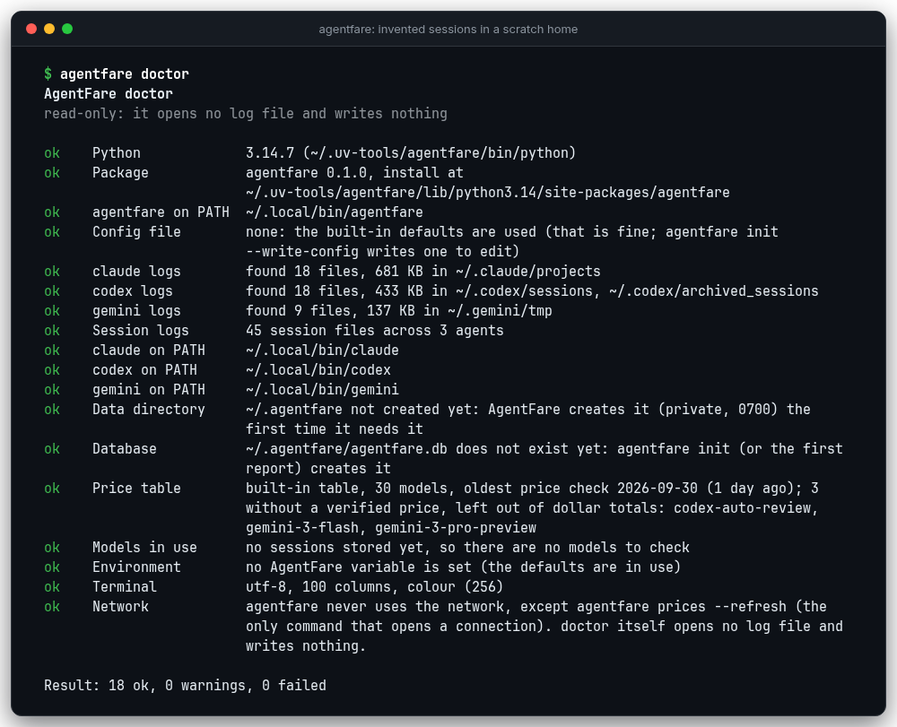

<details>
<summary>agentfare: command not found</summary>

O instalador pôs o comando em uma pasta que o seu shell não procura. O `uv tool update-shell` ou o `pipx ensurepath` a adiciona, e um novo terminal passa a enxergá-la. Até lá, rode o comando pelo caminho completo: `~/.local/bin/agentfare` para o uv e o pipx, e `~/.venvs/agentfare/bin/agentfare` para a instalação pelo pip deste README (ou ative esse ambiente antes). O `~/.local/bin/agentfare doctor` nomeia a pasta a adicionar.

</details>

<details>
<summary>O pip diz que o pacote exige outro Python</summary>

O AgentFare precisa do Python 3.11 ou mais novo, e o seu `python3` é mais antigo (o `python3 --version` mostra). O uv baixa um Python mais novo sozinho, então o `uv tool install` funciona como está escrito. Com o pip ou o pipx, instale antes o Python 3.11 ou mais novo e crie o ambiente virtual com ele, por exemplo `python3.12 -m venv ~/.venvs/agentfare`.

</details>

<details>
<summary>Nenhuma sessão encontrada, ou os números vêm vazios</summary>

Rode o `agentfare doctor`. As linhas `claude logs`, `codex logs` e `gemini logs` dizem quais pastas existem e quantos arquivos cada uma tem, e o `agentfare config` lista as pastas em uso e marca as que faltam. Se um agente guarda os logs em outro lugar, defina `CLAUDE_CONFIG_DIR`, `CODEX_HOME` ou `GEMINI_CLI_HOME`, ou liste as pastas em `sources:` na configuração. O `agentfare init --dry-run` mostra o que uma execução de verdade leria. Um filtro `--since`, `--project` ou `--agent` que não casa com nada também dá um resultado vazio, e então a mensagem diz quais datas têm dados.

</details>

<details>
<summary>Os números parecem errados ou menores que a fatura do meu provedor</summary>

Confira o que o número representa. O AgentFare calcula o preço dos tokens dos logs de sessão pelos preços de tabela da API do provedor, então ele difere de uma fatura ou de uma assinatura. Ele também deixa de fora algumas chamadas que os agentes nunca registram e qualquer modelo sem preço verificado (veja as [Limitações](#limitações)). O `agentfare summary` termina o total com `+` quando um modelo ficou de fora, e o aviso abaixo dele nomeia o modelo. Se os totais parecem velhos, rode o `agentfare ingest`. Se você mudou o `idle_gap_minutes` ou instalou uma versão nova, a próxima execução lê todos os logs de novo sozinha.

</details>

<details>
<summary>Um aviso sobre um modelo sem preço verificado</summary>

A tabela de preços não tem um preço confirmado para esse modelo, então os tokens dele não entram em nenhum valor em dólar. O `agentfare prices --unverified` lista as linhas afetadas. Para contar o modelo, leia o preço dele na página do provedor e adicione-o ao seu próprio arquivo de preços ([Substituindo preços](#substituindo-preços)). O `agentfare prices --refresh` confere a tabela de novo contra as páginas oficiais e não edita nada.

</details>

<details>
<summary>A primeira execução é lenta</summary>

A primeira varredura lê todos os logs que você tem, o que leva cerca de um minuto em um histórico grande, e imprime `first run: reading your agent logs into a local database; this can take a minute` no stderr. As execuções seguintes leem só os arquivos que mudaram. O `agentfare init` é o melhor lugar para esperar por ela. O `--no-ingest` pula a varredura e usa o banco de dados como está.

</details>

<details>
<summary>error: cannot use the database, ou o banco de dados foi gravado por um agentfare mais novo</summary>

A primeira significa que o arquivo está danificado e a segunda significa que um AgentFare mais novo o gravou. A mensagem nomeia o arquivo. Para um arquivo danificado, apague-o e o próximo comando o reconstrói a partir dos logs que ainda existirem. Logs que um agente já apagou não estão em um banco reconstruído, então copie o arquivo antes se você precisa desse histórico. Para a segunda, atualize o AgentFare.

</details>

<details>
<summary>Como eu zero tudo?</summary>

Apague o banco de dados. O próximo comando que precisar de dados (ou o `agentfare init`) o reconstrói a partir dos logs que ainda existirem. Apague também o `~/.agentfare/config.yaml` se quiser os ajustes padrão de volta:

```sh
rm ~/.agentfare/agentfare.db
agentfare init
```

O `agentfare ingest --full` lê todos os logs de novo sem apagar nada.

</details>

<details>
<summary>Como deixo um projeto de fora?</summary>

O AgentFare 0.1.0 não tem um ajuste de exclusão. Os relatórios já escondem os nomes de projeto, a menos que você passe `--show-projects`, e o `--project` mostra um projeto. Para manter as sessões de um projeto fora do banco de dados, aponte `sources` para as pastas que você quer. O Claude Code guarda uma pasta por projeto em `~/.claude/projects`, então você pode listar todas menos uma. Depois apague o banco de dados para que as linhas antigas saiam e rode o `agentfare ingest`. Os logs do Codex CLI e do Gemini CLI não são agrupados por projeto, então isso funciona só para o Claude Code.

</details>

<details>
<summary>Onde o AgentFare guarda os dados dele?</summary>

Em `~/.agentfare`: o banco de dados `agentfare.db` e os arquivos `config.yaml` e `pricing.yaml`, se você os criou. O `AGENTFARE_HOME` ou o `--home` move a pasta. O banco de dados guarda contagens e ids, nunca os seus prompts, respostas ou arquivos ([Privacidade](#privacidade)). Um relatório é gravado onde você mandar (`-o`), ou na pasta atual como `agentfare-report-<semana>.html`.

</details>

<details>
<summary>Ele envia os meus dados para algum lugar?</summary>

Não. O único comando que abre uma conexão é o `agentfare prices --refresh`, e ele só baixa as páginas de preços dos provedores. Um teste falha se qualquer outro módulo conseguir alcançar a rede.

</details>

<details>
<summary>Como desinstalo e apago os meus dados?</summary>

Remova o programa com o comando que corresponde à sua instalação (`uv tool uninstall agentfare`, `pipx uninstall agentfare` ou `pip uninstall agentfare`) e depois apague a pasta de dados:

```sh
rm -r ~/.agentfare
```

Se você instalou o autocompletar com `agentfare --install-completion`, remova a linha que ele acrescentou ao arquivo de inicialização do seu shell e o script de autocompletar que essa linha carrega (no bash é o `~/.bash_completions/agentfare.sh`, e o comando imprimiu o caminho dele).

</details>

<details>
<summary>Por que o advise sugere um modelo que o meu agente não consegue rodar?</summary>

O `advise` compara preços e, por padrão, compara as sessões leves e médias com o `gpt-6.1-sol`. Aponte `router.recommend` para um modelo que o seu agente suporte, por exemplo `claude-sonnet-5-5` para o Claude Code ([Configuração em 60 segundos](#configuração-em-60-segundos)).

</details>

Se nada disso ajudar, [abra uma issue](https://github.com/FernandoSLuz/agentfare/issues/new/choose) e cole o `agentfare doctor --json` com o seu nome de usuário trocado. Nunca cole os seus logs.

## Contribuir, segurança e changelog

* O [CONTRIBUTING.md](CONTRIBUTING.md) cobre a configuração de desenvolvimento, os testes, as invariantes e como adicionar um preço de modelo, um parser ou um comando. Uma mudança na saída, na tabela de preços ou nos padrões da configuração também precisa do `python tests/test_readme.py --write`, que reconstrói as tabelas geradas e os blocos de saída deste arquivo.
* O [docs/DEMO.md](docs/DEMO.md) descreve os dados da demo, as imagens e o GIF, e como desenhá-los de novo.
* O [SECURITY.md](SECURITY.md) diz como relatar uma vulnerabilidade em particular. O [CODE_OF_CONDUCT.md](CODE_OF_CONDUCT.md) define as regras básicas dos espaços do projeto.
* O [CHANGELOG.md](CHANGELOG.md) lista o que mudou em cada versão.

## Licença

O AgentFare é distribuído sob a licença MIT, veja o [LICENSE](LICENSE).

<!-- public-repo-support:start -->
Apoie este projeto: [Buy me a coffee](https://www.buymeacoffee.com/fernandosluz).
<!-- public-repo-support:end -->
